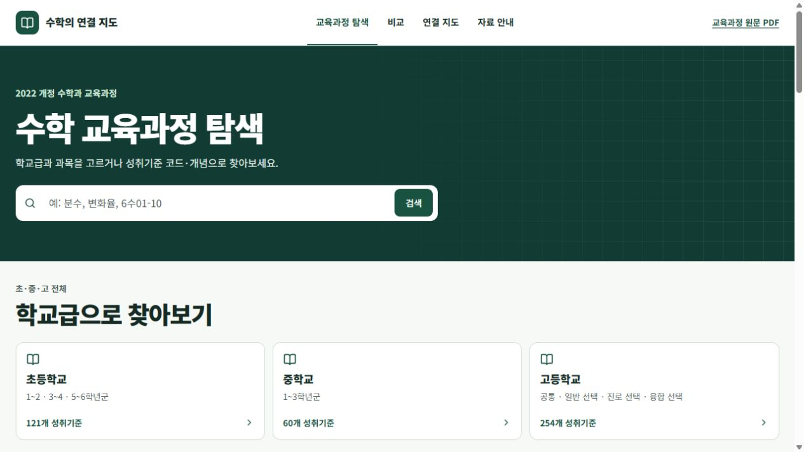
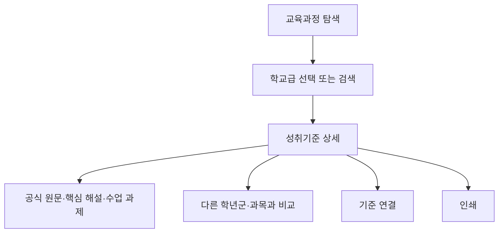

# 수학의 연결 지도

2022 개정 수학과 교육과정의 **초·중·고 성취기준 435개**를 찾아 읽고, 학년군과 과목을 나란히 비교하는 웹 앱입니다. 공식 성취기준에서 상세 분석, 수업 과제, 개념 연결의 근거까지 이어서 볼 수 있습니다.

**[GitHub Pages에서 열기](https://ll7098ll.github.io/math-learning-atlas-kr/)** · [Sites에서 열기](https://math-learning-atlas-kr.gptpro2908176.chatgpt.site/) · [사용자 가이드](docs/USER_GUIDE.md) · [문서 안내](docs/README.md) · [연구·배포 상태](docs/STATUS.md)

[](https://github.com/ll7098ll/math-learning-atlas-kr/actions/workflows/checks.yml)



## 1분 예시 — 비율 성취기준 따라 읽기

1. [교육과정 탐색](https://ll7098ll.github.io/math-learning-atlas-kr/#view=catalog)에서 `6수02-03`을 검색합니다.
2. **비율의 분수 소수 백분율 표현**을 열어 공식 문구와 **원문 PDF 33쪽**을 확인합니다. **수업 과제**를 누르면 빨강 구슬 3개를 파랑 구슬 4개와 비교하는 질문과 기대 설명을 읽을 수 있습니다.
3. **기준 연결**에서 다른 기준과 이어지는 이유를 읽습니다. **찾아보던 목록으로**를 누르면 원래 검색 결과로 돌아갑니다.

[예시 상세 바로 열기](https://ll7098ll.github.io/math-learning-atlas-kr/#view=standard&code=6%EC%88%9802-03) · [같은 기준의 목표별 위계](https://ll7098ll.github.io/math-learning-atlas-kr/legacy.html#view=hierarchy&scope=all&mode=goals&target=6%EC%88%9802-03)



화살표는 **앱 화면의 이동 경로**를 나타냅니다. 연결 지도에 나타나는 학습 관계를 읽는 방법은 [사용자 가이드](docs/USER_GUIDE.md#4-연결-지도와-수업-과제)를 참고하세요.

## 할 수 있는 일

| 하고 싶은 일 | 어디에서 시작하나요? |
|---|---|
| 성취기준 코드·개념을 찾거나 공식 내용 체계 항목을 탐색 | [교육과정 탐색](https://ll7098ll.github.io/math-learning-atlas-kr/#view=catalog) |
| 두 학년군 또는 과목의 성취기준을 나란히 읽기 | [두 범위 비교](https://ll7098ll.github.io/math-learning-atlas-kr/#view=compare) |
| 선택한 기준의 연결을 따라가고 그 이유 읽기 | [연결 지도](https://ll7098ll.github.io/math-learning-atlas-kr/legacy.html#view=network&scope=all) |
| 분수나 비례 같은 개념을 학교급별로 비교 | [개념으로 보기](https://ll7098ll.github.io/math-learning-atlas-kr/legacy.html#view=hierarchy&scope=all) |
| 목표에 필요한 출발 조건, 과제와 대안 경로를 읽기 | [목표별 위계 사용 예시](docs/USER_GUIDE.md#4-연결-지도와-수업-과제) |
| A4 자료를 만들거나 통계·탐구 도구를 열기 | [인쇄와 탐구 도구](docs/USER_GUIDE.md#5-인쇄와-탐구-도구) |

## 연결 지도에서 이어서 보기

기준을 선택하면 직접 이어진 기준을 한 번에 최대 세 개 보여줍니다. 점을 눌러 다음 기준을 보고, 선을 눌러 연결 이유와 적용 조건을 읽습니다. 지나온 연결은 지도에 남아 앞선 기준에서 다른 갈래를 펼칠 수 있습니다. [분수에서 소수까지 이어진 예시](https://ll7098ll.github.io/math-learning-atlas-kr/legacy.html#view=network&scope=all&node=4%EC%88%9801-12&walk=6%EC%88%9801-10%2C0%3A4%EC%88%9801-09%2C1%3A4%EC%88%9801-12) · [435개 기준 전체 지도](https://ll7098ll.github.io/math-learning-atlas-kr/legacy.html#view=network&scope=all&mapMode=full)

## 자료를 읽는 기준

기준은 **교육부 고시 제2022-33호 별책 8 수학과 교육과정**입니다. 상세 화면은 공식 문구와 앱의 자체 해설을 구분해 표시합니다. 개별 경로의 AND는 **그 경로에서 함께 필요한 조건**을 뜻합니다. 대안 경로와 관계의 근거는 해당 과제와 목표의 범위에서 읽으세요.

콘텐츠 `908d62e6b7884436`의 원장에는 성취기준 435개, 하위 목표 870개, 명시적 과제 571개가 있습니다. 571개에는 보존한 이전 설계 1개가 포함됩니다. 문헌 기반 관찰 과제 1,246개는 별도 집계입니다. 독립 검토와 실제 학생 반응 검증은 각각 0건입니다. [집계 원장과 검증 범위](docs/STATUS.md#분석-범위와-현재-집계)

## 로컬에서 실행

저장소 루트에서 Python 정적 서버를 시작한 뒤 [로컬 포털](http://127.0.0.1:8000)을 엽니다.

```sh
python -m http.server 8000 --bind 127.0.0.1 --directory site/dist
```

브라우저가 JSON을 읽을 수 있도록 HTTP 주소로 접속합니다. 서버는 터미널에서 `Ctrl+C`로 종료합니다. 공개 앱은 기존 Sites의 원문 PDF로 연결되며, 로컬에 원문을 준비하는 방법은 별도 안내에서 확인할 수 있습니다. [자료 권리와 원문 준비](docs/RIGHTS.md)

연결선 범례를 적용한 공개 화면은 Sites v128과 GitHub Pages `e128af8`에서 확인했습니다. [공개 버전과 검증 범위](docs/VERIFICATION.md#2026년-11월-26일-연결선-범례와-기준-표시)

## 개발과 기여

| 찾는 내용 | 문서 |
|---|---|
| 파일 위치, 화면과 데이터의 구조 | [구조와 데이터 흐름](docs/ARCHITECTURE.md) · [데이터 안내](docs/DATA.md) |
| 화면 빌드, 연구 원장 수정과 스냅샷 검사 | [개발과 검증](docs/DEVELOPMENT.md) |
| `main`에서 GitHub Pages에 배포하기 | [GitHub 배포 안내](docs/GITHUB.md) |
| 판본과 검증 결과, 주요 변경 | [현재 상태](docs/STATUS.md) · [검증 기록](docs/VERIFICATION.md) · [변경 이력](CHANGELOG.md) |
| 문구·과제·근거의 문제 제보 | [기여 안내](CONTRIBUTING.md) · [자료 권리](docs/RIGHTS.md) |
