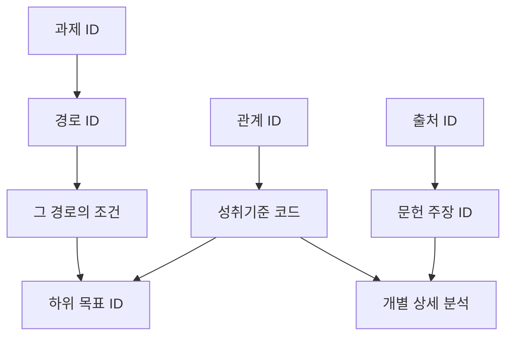

# 데이터 안내

데이터의 의미와 편집 위치를 찾기 위한 안내입니다. 최신 집계는 [현재 상태](STATUS.md)를, 생성 순서는 [개발 안내](DEVELOPMENT.md)를 따릅니다.

## 원본과 생성 결과

| 경로 | 역할 | 변경 시 유의점 |
|---|---|---|
| `data/standards.json` | 공식 기준 코드·문구·쪽수·기준 PDF 해시 | 원문과 표시 보정을 구별 |
| `data/curriculum_structure.json`, `data/curriculum_mapping_reviews.json` | 공식 내용 체계 항목과 성취기준 대응 근거 | 탐색기의 `content/curriculum-structure.json` 생성에 사용 |
| `data/source_corrections.json` | 추출 문장의 대조·보정 | 원래 추출문을 보존 |
| `data/revisions_*.json` | 현재 개별 상세 분석의 편집 원고 | 근거·범위·검토 이력을 함께 유지 |
| `data/initial_case_studies.json` | 초기 세 사례 보존 원고 | 현재 초안과 이력을 혼합하지 않음 |
| `data/goal_hierarchy_*.json` | 하위 목표·과제·경로·조건 원장 | 목표 적용 대상, AND 조건, 대안 경로를 유지 |
| `data/task_route_cases.json` | 대표 과제·경로 자료 | 목표 원장과의 관계를 확인 |
| `data/relations.json` | 기초 관계 원장 | 보강 후 원장의 집계와 구분 |
| `data/revised_relations.json` | 보강 관계 자료 | 생성 결과의 근거 원고도 함께 변경 |
| `data/sources.json` | 출처 ID·서지·접근 범위 | 내려받은 원문의 권리와 구분 |
| `data/literature_claim_reviews.json` | 문헌별 읽기 범위와 주장 검토 | 전체 정독·선택 범위 검토를 구별 |
| `data/relation_literature_reviews.json` | 관계에 적용한 문헌 해석 | 원연구 결론과 자체 적용을 구별 |
| `data/literature_evidence/` | 검토 노트와 일부 증거 자료 | Git에 포함되는 노트와 제외 원문을 구별 |
| `data/teaching_examples/` | 연습·공개 출처·모형 계산 CSV | 가상 관측과 실제 관측을 혼동하지 않음 |
| `analyses/`, `indexes/` | 읽기용 분석·목록 문서 | 생성기의 원본 데이터에 먼저 반영 |
| `site/dist/content/` | 화면이 읽는 현재 자료 | 내용 해시 파일을 직접 편집하지 않음 |

`analysis_details.json`, `secondary_analysis_details.json`과 예전 작성 스크립트는 초기 생성 과정에 해당합니다. 최신 보강 원장을 유지하지 않은 채 이전 생성기만 실행하면 최신 설명을 잃을 수 있습니다.

## 식별자와 관계

화살표는 원장과 화면에서 따라가는 참조를 나타낸다. 한 과제에 여러 경로가 있을 수 있으며 관계는 조건과 적용 범위를 함께 읽는다.

성취기준 코드는 공식 학년군·과목 코드를 따릅니다. 중학교 1~3학년군을 임의의 개별 학년으로 재분류하지 않습니다. 하위 목표·과제·관계·출처 ID는 서로 다른 식별자이며 참조를 유지해야 합니다.

의미 연결, 표현 전환, 일반화, 특정 과제의 선수 조건, 교수 순서는 서로 다릅니다. 방향이 있는 관계라도 보편적인 필수 이수 순서로 승격하지 않습니다. 여러 조건을 모두 요구하는 AND와 같은 과제의 대안을 합쳐 하나의 조건으로 만들지 않습니다.

## 버전과 검사 결과

현재 포털 버전은 `site/dist/content/catalog.json`의 `version`입니다. 과제·개념군 색인에는 같은 콘텐츠 버전과 별도의 `datasetVersion`이 있으며 `files`가 항목별 SHA256 객체를 가리킵니다. `site/snapshot.json`은 이 파일들의 바이트 해시를 기록합니다.

`project_validation.json`, `revision_checks.json`, `goal_network_audit.json` 등은 마지막 실행에서 작성된 검사 기록입니다. 존재한다는 사실만으로 새 변경까지 검증됐다고 간주하지 않습니다. 특히 `project_validation.json`의 기초 관계 수와 `revised_relations.json`의 보강 관계 수는 서로 다른 원장을 셉니다.

독립 검토·학생 반응 검증은 실제 근거 기록이 있을 때만 갱신합니다. 자동 구조 검사나 자체 문헌 대조의 통과를 이 두 상태로 바꾸지 않습니다.
