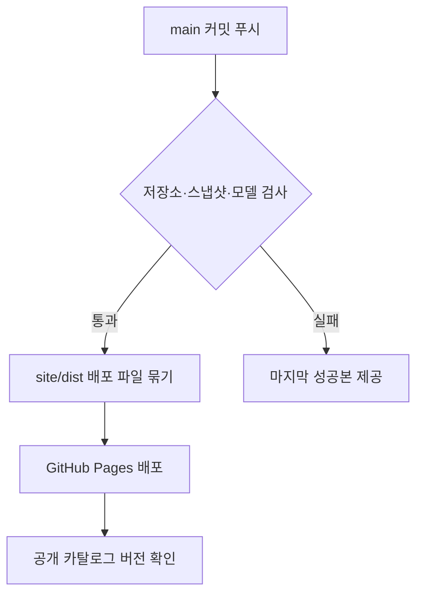

# GitHub 관리와 Pages 배포

2026년 11월 19일 기준. 공개 저장소의 `main` 브랜치에 연구 원장과 포털 스냅샷을 함께 관리한다. Pages는 `main`의 커밋을 검사한 뒤 정적 포털을 배포한다. [공개 저장소](https://github.com/ll7098ll/math-learning-atlas-kr) · [공개 포털](https://ll7098ll.github.io/math-learning-atlas-kr/)

## 포함 범위

| 경로 | 기본 취급 |
|---|---|
| 루트 Markdown, `docs/`, `indexes/`, `analyses/` | 프로젝트 안내, 연구 계획·기록과 상세 분석 포함 |
| `scripts/`, `data/`의 JSON·CSV·검토 노트 | 연구 원본·검증 코드·구조화 자료 포함 |
| `site/dist/`, `site/tests/`, `site/snapshot.json` | 최신 실행 포털의 선별된 스냅샷과 해시 목록 포함 |
| `site/frontend/` | 교육과정 탐색기와 공통 화면 스타일의 소스 포함 |
| `portal/distribution-lab.html`, `portal/inquiry-workbook.html` | 독립 실습 화면 포함 |
| `.github/`, `.gitignore`, `.gitattributes`, `.editorconfig` | Issue·PR 양식, 검사와 저장소 설정 포함 |
| `tmp/` | 다운로드, 작업 사본과 배포 아카이브 제외 |
| 기존 `portal/math-atlas/`, `portal/criterion-connections/`, `portal/layered-network/` | 각각 별도 `.git` 이력이 있는 작업 디렉터리이므로 제외 |
| PDF와 `data/source_review_images/` | 제3자 원문·페이지 이미지 재배포 범위 확인 전 기본 제외 |
| `.openai/`, 인증·환경 파일과 캐시 | 로컬 설정·인증 자료로 제외 |

제외 파일은 디스크에 남는다. 기존 사이트 저장소의 `.git`을 삭제하거나 루트 저장소의 하위 모듈로 임의 등록하지 않는다. `site/`는 기존 사이트 저장소 이력과 분리한 실행 스냅샷이다. 원문 PDF와 이미지가 없어도 저장소에 포함된 포털의 분석·탐색 기능을 실행할 수 있지만, 원문 PDF 보기와 원문 해시·이미지 대조 검사는 해당 파일을 별도로 확보해야 한다.

출처와 이용 조건은 [자료 권리 안내](RIGHTS.md)를 따른다. `.gitignore`는 이미 추적된 파일을 자동으로 제거하지 않는다. 공개하기 전 실제 커밋 대상과 변경 이력을 확인한다.

`.gitattributes`의 `* -text`는 기존 파일의 바이트를 유지한다. 현재 원장·검토 노트·포털에 CRLF와 LF가 함께 있으며, 증거와 스냅샷 SHA256은 실제 바이트를 검증한다. Git이 줄바꿈을 자동 변환하면 새로 복제한 환경에서 해시가 달라질 수 있으므로 일괄 정규화하지 않는다. `.editorconfig`는 이후 편집의 기준이며, 검토된 파일을 편집했을 때는 해당 검토 상태와 스냅샷을 함께 갱신한다.

## 로컬 준비

저장소 루트에서 다음 검사를 실행한다.

```text
python scripts/check_repository.py
python scripts/test_goal_hierarchy.py
python scripts/test_hierarchy_review.py
python scripts/test_content_completion.py
python scripts/test_general_math_models.py
python scripts/test_advanced_math_models.py
```

`check_repository.py`는 지정한 소스 디렉터리와 루트 파일만 읽는다. 파일 크기, UTF-8, 알려진 자격 증명 형식과 Markdown의 인라인 로컬 파일 링크를 검사한다. `tmp/`와 제외된 중첩 저장소를 순회하지 않는다. 제외된 PDF·작업 사본 링크는 로컬 전용 참조로 집계하며, 일반 누락 링크와 구분한다. 외부 URL, 문서 내 앵커, 참조형 Markdown 링크, 전체 비밀값 유형과 Git 커밋 이력은 검사 범위 밖이다. `--json`은 전체 보고서를 표준 출력으로 표시하며 파일은 바꾸지 않는다.

포털은 다음 명령으로 연 뒤 `http://127.0.0.1:8000`에서 확인한다.

```text
python -m http.server 8000 --bind 127.0.0.1 --directory site/dist
```

## 변경 커밋과 업로드

새 작업 폴더가 필요하면 공개 저장소를 복제한다. 기존 작업 폴더에서는 `git status --short --branch`와 `git remote -v`로 변경 목록과 `origin`을 확인한다.

```text
git clone https://github.com/ll7098ll/math-learning-atlas-kr.git
```

아래는 README와 변경 기록만 수정한 경우의 예다. 연구 내용을 갱신했다면 공개 가능한 원장·근거 노트·생성 문서와 대응하는 포털 스냅샷도 검토해 커밋에 포함한다.

```text
git add -- README.md CHANGELOG.md
git diff --cached --stat
git diff --cached --name-status
git commit -m "docs: update project documentation"
git push origin main
```

커밋 목록을 검토할 때 [자료 권리 안내](RIGHTS.md)에 있는 제외 경로를 확인한다. 인증에는 본인의 GitHub 자격 증명 관리 도구를 사용한다.

## GitHub Pages 자동 배포

GitHub Pages의 배포 소스는 GitHub Actions다. `main`에 push하거나 `main`에서 워크플로를 수동 실행하면 저장소 검사를 거쳐 `site/dist/`가 배포된다. [공개 포털](https://ll7098ll.github.io/math-learning-atlas-kr/) · [검사와 배포 실행 기록](https://github.com/ll7098ll/math-learning-atlas-kr/actions/workflows/checks.yml)



포털 콘텐츠를 고친 경우 [스냅샷 갱신 절차](DEVELOPMENT.md#github-스냅샷-갱신)에 따라 `site/dist/`, 필요한 `site/tests/`, `site/snapshot.json`을 함께 올린다. Pages는 커밋된 정적 스냅샷을 사용하므로 연구 원장이나 Markdown만 수정하면 화면 데이터는 그대로다.

검사가 실패하면 해당 배포가 중단되고 마지막 성공본이 계속 제공된다. 배포 파일의 교육과정 원문 링크는 기존 공개 포털의 PDF를 가리킨다.

배포가 끝나면 Actions의 `deploy-pages` 결과와 공개 카탈로그의 `version`을 확인한다. 공개 카탈로그 값은 배포한 커밋의 `site/snapshot.json`에 있는 `data_version`과 일치해야 한다. [공개 카탈로그](https://ll7098ll.github.io/math-learning-atlas-kr/content/catalog.json)

## 자동 검사 범위

[GitHub Actions 설정](../.github/workflows/checks.yml)은 push·pull request·수동 실행에서 공개 파일 점검, Python 검사 5종, 포털 스냅샷 해시 검증과 Node.js 검사 3종을 실행한다. 검사 환경은 Python 3.12와 Node.js 24를 사용한다. 검사 작업에는 저장소 읽기 권한을 부여하며, Pages 배포 작업에는 Pages 쓰기와 토큰 발급 권한을 부여한다. 원문 파일과 로컬 작업 폴더에 의존하는 전체 연구 검사는 개발 환경에서 실행한다.

워크플로의 `actions/checkout@v7`, `actions/setup-python@v7`, `actions/setup-node@v7`는 작성일에 확인한 [checkout 공식 안내](https://github.com/actions/checkout), [setup-python 공식 안내](https://github.com/actions/setup-python), [setup-node 공식 안내](https://github.com/actions/setup-node)의 사용 예를 따랐다. Python·Node.js 버전은 최신 버전 표기가 아니라 이 프로젝트의 검증 환경이다.

## 파일 크기와 라이선스

GitHub는 일반 Git 파일이 50 MiB를 넘으면 경고하고 100 MiB를 넘으면 업로드를 막는다. 이 프로젝트는 원본 작업 폴더 전체를 올리지 않고 현재 자료와 선별된 스냅샷만 포함한다. [GitHub 파일 크기 안내](https://docs.github.com/en/repositories/working-with-files/managing-large-files/about-large-files-on-github)

라이선스가 지정되지 않은 공개 저장소를 곧바로 오픈소스로 간주하지 않는다. 프로젝트 코드·자체 분석·제3자 원문에 적용할 범위를 구분한 뒤 소유자가 라이선스를 정한다. 현재 단계에서는 임의의 `LICENSE` 파일을 추가하지 않았다. [GitHub 라이선스 안내](https://docs.github.com/en/repositories/managing-your-repositorys-settings-and-features/customizing-your-repository/licensing-a-repository)

