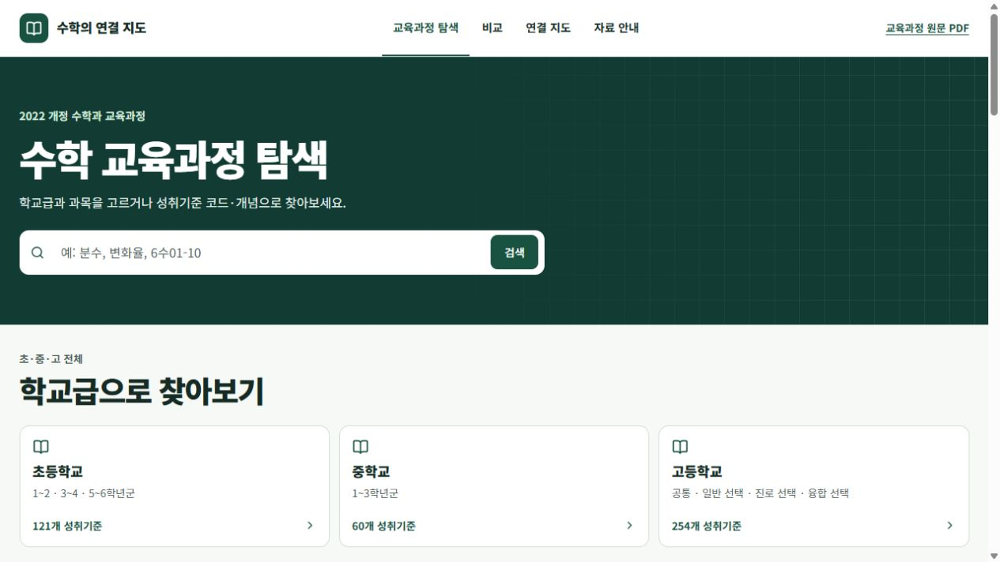
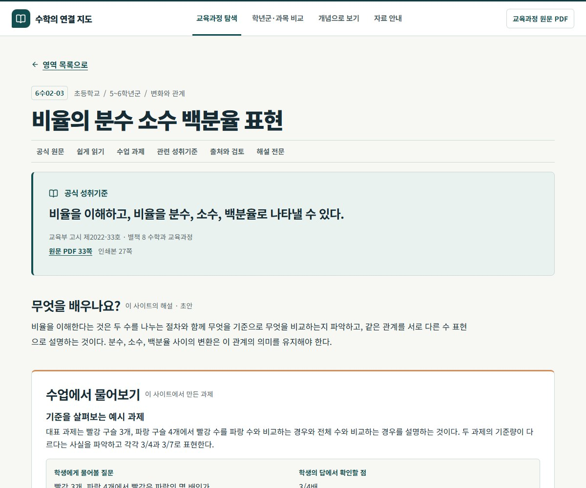

# 수학의 연결 지도 사용자 가이드

학년군에서 기준을 찾거나, 알고 있는 코드로 바로 들어가세요. 아래 화면은 2026년 11월 26일 배포용 로컬 스냅샷에서 캡처했습니다. 콘텐츠 판본은 `908d62e6b7884436`입니다. [공개 앱 열기](https://ll7098ll.github.io/math-learning-atlas-kr/) · [프로젝트 README](../README.md)

## 1. 성취기준과 내용 체계 찾기

- **내 수업 범위에서 찾기** — 첫 화면에서 학교급을 고르고, 초·중학교는 학년군을, 고등학교는 과목을 선택합니다. 영역을 고르면 그 범위의 기준을 읽을 수 있습니다.
- **개념이나 코드로 찾기** — 검색창에 `분수`나 `6수02-03`을 입력합니다. 결과에서 기준 제목을 누르면 공식 문구와 수업 자료가 열립니다. [비율 코드 검색 결과](https://ll7098ll.github.io/math-learning-atlas-kr/#view=catalog&q=6수02-03)
- **공식 내용 체계 찾기** — 첫 화면의 **공식 내용 체계 보기**에서 핵심 아이디어, 지식·이해, 과정·기능, 가치·태도와 각 항목의 적용 범위를 확인합니다.

## 2. 성취기준 상세 읽기

`6수02-03`을 검색해 **비율의 분수 소수 백분율 표현**을 엽니다. **공식 성취기준**에서 고시 문구를, **원문 PDF 33쪽**에서 해당 판면을 확인합니다. 책에 인쇄된 쪽수는 27쪽입니다. [비율 기준 상세](https://ll7098ll.github.io/math-learning-atlas-kr/#view=standard&code=6수02-03)

**수업 과제**를 누르면 빨강 구슬 3개와 파랑 구슬 4개로 기준량을 비교하는 질문이 나옵니다. 빨강을 파랑과 비교하면 3/4배, 구슬 전체와 비교하면 3/7입니다. 화면의 **학생의 답에서 확인할 점**은 자체 설계에서 예상한 답입니다. **출처와 검토 내용**에서 적용 범위와 실제 검토 상태를 확인하고 **찾아보던 목록으로** 돌아갈 수 있습니다.

## 3. 학년군·과목 비교

상단 **학년군·과목 비교**에서 **분수의 의미와 나눗셈 예시 열기**를 누릅니다. `4수01-09`에서는 양을 똑같이 나누어 분수를 이해하고, `6수01-10`에서는 자연수를 자연수로 나눈 몫을 분수로 나타냅니다. 각 결과의 제목을 눌러 상세를 열거나 **왼쪽과 오른쪽 바꾸기**으로 순서를 바꿀 수 있습니다. 직접 비교하려면 양쪽 학년군·과목과 영역을 고르세요. [학년군·과목 비교](https://ll7098ll.github.io/math-learning-atlas-kr/#view=compare)

## 4. 연결 지도와 수업 과제

상단 **연결 지도**를 열면 분수 기준이 가운데 있는 예시 지도가 보입니다. 다른 곳에서 시작하려면 학년군·과목이나 개념을 고른 뒤 원하는 기준을 누르세요. [연결 지도](https://ll7098ll.github.io/math-learning-atlas-kr/legacy.html#view=network&scope=all)

주변 점을 누르면 **내가 따라온 길**이 열립니다. 둥근 사각형은 출발점, 주황색은 지금 보는 기준입니다. 실선은 이미 따라온 연결이고, 점선은 지금 보는 점에서 더 갈 수 있는 연결입니다. 지도 위에 출발점부터 지금 보는 기준까지 이름이 표시됩니다. 앞선 기준 이름을 누르면 따라온 길을 남겨 둔 채 다른 갈래를 펼 수 있습니다. 선을 누르거나 **연결 이유 보기**에서 상대 기준 이름을 고르면 두 기준이 이어지는 이유와 적용 조건이 열립니다. 경로가 길어지면 **출발점 찾기**와 **지금 보는 점 찾기**로 위치를 확인하세요. 주소를 복사해 두면 같은 지도를 다시 열 수 있습니다. **435개 기준 전체 지도 보기**에서는 모든 점을 함께 볼 수 있습니다. [전체 지도](https://ll7098ll.github.io/math-learning-atlas-kr/legacy.html#view=network&scope=all&mapMode=full)

홈의 **두 기준이 이어지는 이유**를 누르면 분수 예시의 근거를 읽을 수 있습니다. **분수·소수·유리수**에서 학년군을 펼쳐 개별 기준을 읽거나 **두 기준에서 달라지는 점 보기**를 선택하세요. 초등 분수와 중학교 유리수의 두 공식 문장을 읽고 **왜 연결되는지 보기**에서 자체 분석을 확인할 수 있습니다. 다른 개념은 상단 **개념으로 보기**에서 찾습니다. [분수·소수·유리수](https://ll7098ll.github.io/math-learning-atlas-kr/legacy.html#view=hierarchy&concept=fraction&scope=all)

과제의 조건을 찾으려면 기준 상세의 **목표에 필요한 것과 쓰이는 곳**을 엽니다. 목표별 화면의 **수업 과제와 풀이**에서는 같은 목표에 이르는 풀이가 여럿이면, 각 방법에서 무엇이 함께 필요한지 읽어 보세요. [비율 기준의 목표별 화면](https://ll7098ll.github.io/math-learning-atlas-kr/legacy.html#view=hierarchy&scope=all&mode=goals&target=6수02-03) · [자료의 검토 범위](STATUS.md)

## 5. 인쇄와 탐구 도구

기준 상세에서 **인쇄**, 비교 화면에서 **비교 인쇄**를 누르고 인쇄 대화상자의 A4 미리보기를 확인합니다. **PDF로 저장**을 선택해 수업 준비 자료로 보관할 수도 있습니다.

**자료 안내**의 **탐구 도구**에서 **정규분포와 t분포 탐구**를 열어 자유도에 따라 곡선과 확률이 어떻게 달라지는지 확인합니다. **수학 탐구 기록지**에서는 계획, 풀이, 돌아보기에 쓸 항목을 찾아 인쇄할 수 있습니다. [자료 안내](https://ll7098ll.github.io/math-learning-atlas-kr/legacy.html#view=about) · [로컬 실행 방법](DEVELOPMENT.md#github-스냅샷을-로컬에서-보기)
