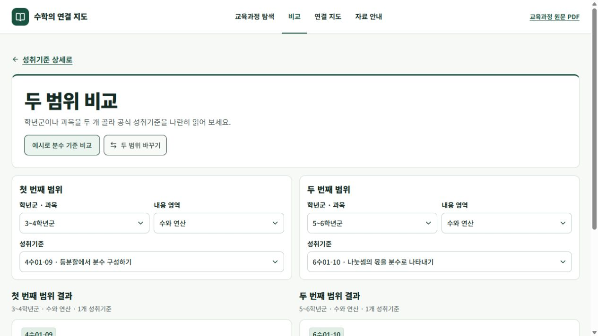
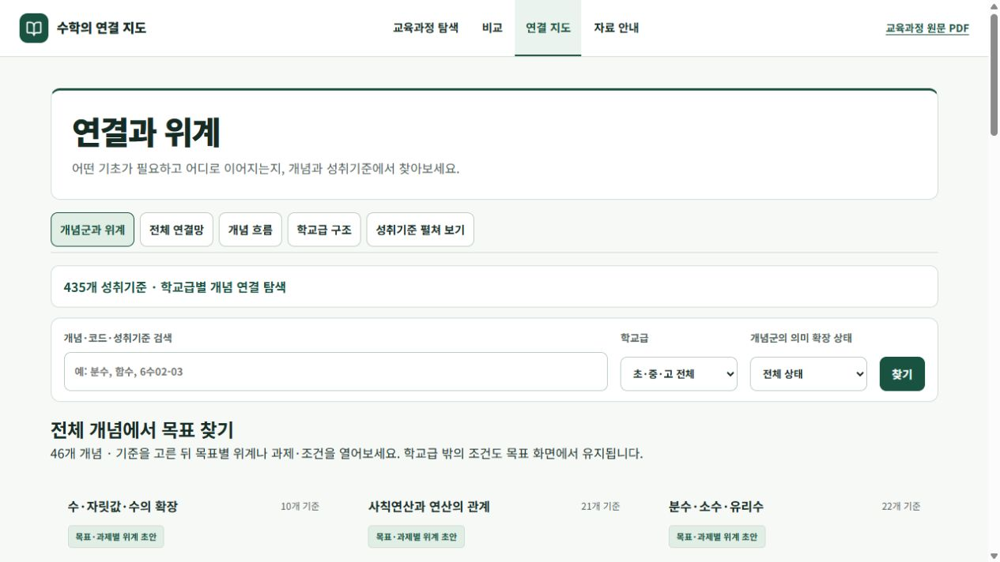

# 수학의 연결 지도 사용자 가이드

교사·연구자·교육과정에 관심 있는 사람이 성취기준을 찾고 비교하는 방법을 안내합니다. 2026년 11월 20일의 GitHub 배포용 스냅샷 `908d62e6b7884436`에서 화면을 캡처했습니다. [공개 앱 열기](https://ll7098ll.github.io/math-learning-atlas-kr/) · [프로젝트 README](../README.md)

| 순서 | 해볼 일 |
|---|---|
| 1 | [검색과 학교급 선택](#1-성취기준과-내용-체계-찾기) |
| 2 | [공식 문구·분석·과제 읽기](#2-성취기준-상세-읽기) |
| 3 | [두 범위 나란히 비교](#3-두-범위-비교) |
| 4 | [연결 지도와 목표별 위계](#4-연결-지도와-목표별-위계) |
| 5 | [인쇄와 탐구 도구](#5-인쇄와-탐구-도구) |

## 1. 성취기준과 내용 체계 찾기

1. **교육과정 탐색**의 검색창에 `6수02-03`, `분수`, `변화율`처럼 코드나 개념을 입력하고 **검색**을 누릅니다. 처음부터 범위를 좁히려면 초등학교·중학교·고등학교 카드에서 시작합니다.
2. 학교급 안에서는 학년군 또는 과목, 내용 영역으로 범위를 좁힐 수 있습니다. 중학교 공식 범위는 **1~3학년군**입니다.
3. 결과의 **성취기준** 탭에서 공식 문구와 상세 링크를 봅니다. **내용 체계** 탭에서는 핵심 아이디어, 지식·이해, 과정·기능, 가치·태도 항목과 연결해 둔 성취기준을 봅니다.

[비율 코드 검색 결과 열기](https://ll7098ll.github.io/math-learning-atlas-kr/#view=catalog&q=6%EC%88%9802-03)

## 2. 성취기준 상세 읽기

**비율의 분수 소수 백분율 표현**을 열면 상단에 코드 `6수02-03`, 학년군, 영역이 보입니다. **공식 성취기준** 카드에서 고시 문구를 읽고 **PDF 33쪽 열기**로 원문을 확인할 수 있습니다. 화면의 ‘원문 표기 27쪽’은 문서에 인쇄된 쪽수입니다.

그 아래 **분석과 수업 과제**에서 **핵심 의미와 적용 범위**, **대표 과제와 진단 질문**, **관계와 근거**를 순서대로 펼칩니다. 과제를 수업에 참고할 때는 학생에게 요구하는 설명과 관찰할 오류를 함께 읽으세요. 더 긴 해설은 **전체 상세 분석 목차**에서 열 수 있습니다. **찾아보던 목록으로**를 누르면 검색 결과로 돌아갑니다.

[6수02-03 상세 열기](https://ll7098ll.github.io/math-learning-atlas-kr/#view=standard&code=6%EC%88%9802-03)

## 3. 두 범위 비교

상단의 **비교**에서 양쪽의 **학년군 · 과목**, **내용 영역**, **성취기준**을 선택합니다. 한 영역의 문구를 모두 읽을 때는 **선택 영역의 모든 기준**을 고릅니다. 상세 화면에서 **다른 범위와 비교**를 누르면 보고 있던 기준을 첫 번째 범위로 가져옵니다.

처음에는 **예시로 분수 기준 비교**를 눌러 보세요. `4수01-09`의 등분할에서 분수를 구성하는 기준과 `6수01-10`의 나눗셈의 몫을 분수로 나타내는 기준이 나란히 놓입니다. **두 범위 바꾸기**로 순서를 바꿔 볼 수 있습니다. 두 공식 문구에서 학생이 수행해야 하는 행동을 비교한 뒤 각 결과의 상세를 열어 차이를 더 살펴봅니다.

[비교 화면 열기](https://ll7098ll.github.io/math-learning-atlas-kr/#view=compare)

## 4. 연결 지도와 목표별 위계

1. 상단 **연결 지도**에서 **개념군과 위계**를 열고 `6수02-03`을 검색합니다.
2. **비·비율·비례·유리함수** 결과의 해당 기준에서 **목표별 위계 보기**를 선택합니다.
3. 하위 목표를 고른 뒤 **과제에서 사용하는 출발 조건**을 확인합니다. 사용하는 과제에 따라 필요한 조건과 경로가 달라질 수 있습니다. 개념군 검색 결과의 **과제와 전체 조건**을 열면 과제와 경로별 설명을 펼쳐 볼 수 있습니다.
4. 더 넓은 흐름을 보려면 **전체 연결망**, **개념 흐름**, **학교급 구조**로 바꿉니다.

[연결 지도](https://ll7098ll.github.io/math-learning-atlas-kr/legacy.html#view=hierarchy) · [비율 기준의 목표별 위계](https://ll7098ll.github.io/math-learning-atlas-kr/legacy.html#view=hierarchy&scope=all&mode=goals&target=6%EC%88%9802-03)

| 화면에 보이는 표시 | 읽는 방법 |
|---|---|
| 의미 연결 | 두 성취기준을 잇는 개념적 근거와 적용 범위를 읽습니다. |
| 과제의 출발 조건 | 선택한 과제·목표에서 사용하는 부분 수행입니다. |
| 전체 AND 조건 | 표시된 조건을 그 경로에서 함께 사용합니다. |
| 대안 경로 | 각 경로의 조건을 따로 읽고 어떤 목표에 적용되는지 확인합니다. |

상세 해설과 위계는 자체 설계 초안입니다. 특정 과제의 연결을 과목 이수 조건이나 모든 학생의 학습 순서로 확대하지 않습니다. 출처별 지원 범위와 실제 검토 상태는 [현재 상태](STATUS.md)에서 확인하세요.

## 5. 인쇄와 탐구 도구

상세 화면에서 **분석과 수업 과제**가 표시되고 **인쇄** 버튼이 활성화되면 누릅니다. 브라우저의 인쇄 대화상자에서 **A4**를 고르고 미리보기의 제목, 과제, 페이지 나눔을 확인하세요. 프린터 대신 **PDF로 저장**을 선택할 수도 있습니다. [인쇄 검증 기록](VERIFICATION.md#성취기준-상세-인쇄와-공개-화면)

**자료 안내 → 탐구 도구**에는 자유도에 따라 곡선과 확률을 확인하는 **정규분포와 t분포 탐구**, 탐구 계획·수행·성찰을 기록하고 인쇄하는 **수학 탐구 기록지**가 있습니다. [자료 안내](https://ll7098ll.github.io/math-learning-atlas-kr/legacy.html#view=about)

화면에 이전 버전의 자료가 남았다는 메시지가 표시되면 새로고침합니다. 로컬에서 파일을 직접 열었을 때 자료가 보이지 않으면 [HTTP 실행 방법](DEVELOPMENT.md#github-스냅샷을-로컬에서-보기)을 따릅니다.
