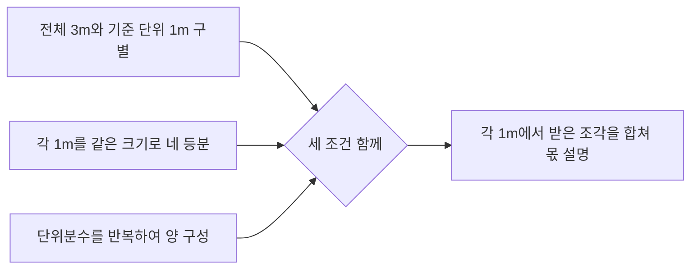

# 수학 교육과정의 위계와 학습 순서 설계 계획

작성일: 2026년 10월 29일

진행 결과: [세 개념군의 위계 시범 분석 결과](위계시범분석결과.md). 28개 사고와 32개 관계를 여섯 설명 경로로 정리하고 경로별 배치에 반영했다. 수학적 자체 점검 초안이며 독립 검토와 학생 반응 검증은 남아 있다. 아래의 기존 구조 감사는 계획 수립 시점의 스냅샷이다.

포털의 중심 경험을 **선택한 개념을 이해하는 데 필요한 기초, 함께 다룰 개념, 이후 확장되는 개념을 근거와 함께 읽는 것**으로 보완한다. 현재 구현된 주변 지도는 관계를 양옆에 나누어 놓으므로 학습의 방향을 설명하지 못한다. 다음 구현에서는 먼저 관계의 교육적 의미를 정리하고, 그 결과로 배치 단계를 계산한다.

## 현재 자료에서 확인한 공백

[위계 감사 결과](../data/hierarchy_audit.json)는 [감사 스크립트](../scripts/audit_curriculum_hierarchy.py)로 재생성할 수 있다. 분석 시점의 관계 파일 SHA256은 결과 파일에 기록했다. 원본 분석과 관계는 변경하지 않았다.

| 항목 | 확인 결과 | 설계에 주는 의미 |
|---|---:|---|
| 성취기준 | 435개 | 전체 교육과정의 위치는 모두 표시 가능 |
| 성취기준 사이 관계 기록 | 1,518개 | 의미 연결 1,376, 확장 135, 대조 7 |
| 과제별 선수 조건 | 7개, 성취기준 3개에 집중 | 전체 학습 위계를 만들기에는 부족 |
| 명시적인 교수 순서 관계 | 0개 | 수업 순서를 자동으로 제시할 근거가 없음 |
| 중고등 이전 목표 설명 | 313건 | 선수 후보를 검토할 자료 |
| 중고등 이후 목표 설명 | 313건 | 확장과 수업 순서를 구별하며 검토할 자료 |
| 전체 성취기준 관계의 방향 순환 | 2개 노드로 이루어진 묶음 3개 | 전체 관계를 하나의 선후 순서로 정렬할 수 없음 |
| 확장 관계만의 방향 순환 | 0개 | 개념 확장 보기를 시범 구성할 수 있으나 선수 관계 검증을 대신하지 않음 |

의미 연결에서 순환은 오류가 아니다. 이를 순서 그래프로 변환할 때만 문제가 된다. 순환을 없애려고 원자료의 선을 지우지 않고, 순서를 주장하는 관계만 따로 검토한다. 이전·이후 목표의 626건은 고유한 연결 수나 검토 완료 수가 아닌 설명 기록의 수다.

현재 코드의 주변 지도는 관계 기록 ID와 노드 수에 따라 배치되고, 지도 좌우 위치는 관계 방향과 무관하다. 따라서 선 모양을 바꾸는 것만으로 해결할 수 없다. 데이터의 순서 주장과 화면의 배치 규칙을 함께 보완해야 한다.

## 서로 다른 네 가지 위계

| 보기 | 답하려는 질문 | 순서를 정하는 근거 | 화면 표현 |
|---|---|---|---|
| 교육과정 위치 | 어느 학교급과 학년군, 과목에 있는가 | 공식 문서의 분류와 범위 | 학년군별 열과 과목 분기 |
| 개념의 구성 | 목표가 어떤 개념과 사고로 이루어지는가 | 정의, 수행 분해, 포함 관계 | 성취기준 아래 사고 요소를 펼치는 구조 |
| 개념의 발달과 확장 | 무엇이 유지되고 어떻게 더 정교해지는가 | 학습 발달 연구와 수학적 분석을 각각 표시 | 기초 의미에서 확장 의미로 향하는 단계 |
| 선택한 수업의 선후 관계 | 이 과제에서 무엇을 먼저 확인하고 어떤 경로로 가르칠까 | 과제의 조건, 대안 풀이, 수업 설계와 학생 반응 | 선수 조건의 묶음, 병렬 단계와 대안 경로 |

첫 화면은 교육과정 위치를 보여주고, 개념 선택 후에는 발달·확장 보기와 수업 경로 보기를 제공한다. 개념의 구성은 상세 화면에서 펼친다. 같은 높이에 놓인 항목은 해당 보기에서 순서가 정해지지 않았다는 뜻이며 난이도가 동일하다는 뜻은 아니다.

## 조사 결과와 적용 범위

### 목표와 사고 단계와 활동을 함께 다루기

[Clements와 Sarama의 Learning Trajectories](https://www.learningtrajectories.org/)는 목표, 사고의 발달 단계, 그 단계에 대응하는 활동을 함께 제공한다. 포털에도 각 단계의 이름뿐 아니라 학생의 설명·수행으로 구별할 수 있는 진단 과제를 붙이는 설계가 적합하다. 해당 서비스는 유아·초기 수학을 대상으로 하므로 고등 수학의 계통을 그대로 설명하는 근거로 확대하지 않는다.

[IES의 Teaching Math to Young Children](https://ies.ed.gov/ncee/WWC/PracticeGuide/18)은 수와 연산, 기하·측정 등의 발달적 계열과 학생의 현재 이해에 대한 점검을 권고한다. 따라서 개념을 미리 배웠다는 정보와 실제로 필요한 사고를 구성했다는 정보를 구별하는 질문이 필요하다. 이 지침 역시 유아 대상이라는 범위를 유지한다.

### 핵심 개념의 축적을 보여주기

[영국 교육부의 초등 수학 지도 지침](https://www.gov.uk/government/publications/teaching-mathematics-in-primary-schools)은 이후 학습에 필요한 핵심 개념과 학년 간 이해의 축적을 다룬다. 한국 자료에서는 공식 성취기준과 별도로 개념의 연결 축을 만들고, 그 축에 여러 기준을 대응시키는 방법을 검토할 수 있다. 영국의 학년 배치를 한국 학년군에 직접 대입하지 않는다.

[Coherence Map](https://achievethecore.org/page/2801/learn-more-about-the-coherence-map)은 기준에서 이전의 논리적 선수 기준을 역추적하고 과제 자료로 확인하는 탐색을 제공한다. 우리 포털도 목표에서 필요한 기초로 거슬러 올라가는 탐색을 우선한다. 그 관계 자체는 한국 자료로 다시 분석한다.

### 분수 연구에서 발달 순서와 동시 발달 구별하기

[Wilkins와 Norton의 2018년 연구](https://link.springer.com/article/10.1186/s40594-018-0119-2)는 부분과 전체의 분수 이해에서 측정으로서의 분수 이해로 나아가는 모형을 제시한다. 모형에는 발달적 선수 조건과 방향을 정할 수 없는 동시 발달 관계가 구별되어 있다. 이는 분수 영역에서도 모든 연결을 한 방향 순서로 만들 수 없음을 보여주는 구체 사례다. 한국 성취기준에 대한 대응은 별도로 검토한다.

위 자료들이 지지하는 설계 방향은 목표를 잘게 나누고, 관찰 가능한 사고의 변화와 활동을 함께 기록하는 것이다. 초중고 전체를 포괄하는 하나의 검증된 학습 사슬이 이번 조사에서 확보된 것은 아니다. 첫 연구 단위는 범위가 좁은 개념군으로 잡는다.

## 관계를 판정하는 분석 절차

각 후보 관계에 대해 다음 질문을 순서대로 검토한다.

1. 도착 목표에서 어떤 수행과 설명을 요구하는가. 성취기준 안에 여러 목표가 있으면 먼저 분리한다.
2. 선택한 과제를 해결하거나 의미를 설명하려면 출발 개념의 무엇이 쓰이는가.
3. 그 사고 없이도 가능한 다른 해결 경로가 있는가. 계산 결과만 맞히는 것과 의미를 설명하는 수행은 구별한다.
4. 필요한 관계라면 어떤 경로·표현·수 범위에서 필요한가. 여러 조건이 모두 필요한지, 대안 중 하나로 충분한지 기록한다.
5. 순서가 수학적 논증인지, 관찰된 발달 관계인지, 교사의 수업 제안인지 판정한다.
6. 관계를 확인하거나 반박할 진단 과제와 반례를 함께 제시한다.

예를 들어 비율에서 정비례로 가는 `L007`은 `9수02-07`의 정비례 부분에 한정된 확장이다. 정비례와 반비례를 함께 다루는 성취기준 전체의 필수 선수 관계로 자동 승격하지 않는다. 표상 전환 역시 항상 구체물→그림→식으로 고정하지 않고, 선택한 경로와 학습자의 출발점에 따라 검토한다.

기존 `requires_for_task`는 과제별 조건이라는 의미를 유지한다. 새 위계 주장 기록에는 아래 정보를 추가한다. 우선 별도 후보 파일에서 관리하고 검토 후 기존 데이터와 연결한다.

| 필드 | 내용 |
|---|---|
| 출발·도착 대상 | 성취기준 또는 분해한 개념·사고 요소의 ID |
| 주장 종류 | 과제별 필요 조건, 학습 지원, 의미 확장, 교수 순서, 병렬·동시 발달 |
| 목표 수행과 경로 | 무엇을 할 때 필요한지와 적용 경로 |
| 조건 묶음 | 함께 필요한 AND 조건과 대안 경로의 OR 조건 |
| 이유와 반례 | 연결의 논증, 다른 경로, 성립하지 않는 조건 |
| 근거 | 출처의 정확한 위치, 연구 대상과 과제, 자체 분석 여부 |
| 확인 과제 | 관찰할 설명·그림·행동과 판정 기준 |
| 검토 이력 | 작성자, 검토자, 수정 이유, 미해결 쟁점, 상태 |

근거 종류와 검토 상태는 별개의 축으로 둔다. 논문이 붙은 관계를 자동으로 검토 완료로 바꾸거나 수치형 신뢰도를 임의로 산출하지 않는다. 학년, 성취기준 번호, 그래프의 연결 수도 위계 판정의 대용으로 사용하지 않는다.

## 화면 배치 계획

기본 방향은 **왼쪽의 기초 → 가운데의 선택 목표 → 오른쪽의 확장**이다. 목표를 선택하면 직접 필요한 기초와 이후 확장을 먼저 표시하고, 같은 단계의 항목은 세로로 나란히 놓는다. 의미 연결은 기본 위계의 순위를 바꾸지 않는 보조선으로 선택해 표시한다.

학습 순서 보기에서는 검토한 방향 관계만으로 부분 순서를 만든다. 부분 순서란 일부 항목 사이의 선후만 정하고, 나머지는 나란히 둘 수 있는 구조다. 단계 번호는 선택한 목표와 경로에 따른 상대 위치이며 학생의 능력 등급이 아니다.

- 선수 관계는 왼쪽에서 오른쪽으로 향하게 배치한다. 같은 선수 요소를 여러 번 복제하기보다 공유 참조를 쓴다.
- AND 조건은 합류 지점으로 묶고, OR 경로는 갈라진 경로로 표시한다. 선수 조건의 충족을 표시하려면 개별 간선이 아니라 조건 묶음 전체를 계산해야 한다.
- 동시 발달과 순서 미정은 같은 단계 또는 별도 묶음으로 둔다. 억지로 순서를 만들지 않는다.
- 의미 확장만 확인된 구간에는 의미 확장이라고 표시하고 선수 조건과 다른 선을 쓴다.
- 아직 근거를 조사하지 않은 구간은 위계 미검토로 표시한다. 관계가 없다는 이유로 기초 단계로 배치하지 않는다.
- 순서 주장에 순환이 나오면 검토 목록에 남긴다. 독립적으로 정의되지 않은 개념, 서로 다른 과제, 대체 과목 등이 섞였는지 확인한다.

아래는 기존 자료의 끈 분배 과제를 이용한 배치 예시다. 세 조건은 기존 `L001`~`L003`의 같은 AND 묶음이며, 전체를 먼저 네 등분하는 대안 경로에는 그대로 강제하지 않는다.

넓이에서는 조각의 손실·겹침을 확인하는 재배치 경로, 합동 도형 두 개를 이용하는 경로, 선택한 밑변과 높이를 해석하는 경로를 비교한다. 한 경로의 선수 조건을 모든 넓이 과제에 강제하지 않는지 확인하는 시범 사례로 사용한다.

## 우선 조사할 개념군

| 개념군 | 확인할 위계 | 산출물 |
|---|---|---|
| 단위와 분수 | 전체·단위·등분·반복·일반 분수의 관계 | 발달 연구와 연결된 사고 단계 및 진단 과제 |
| 비율과 함수 | 비교량·기준량에서 불변량, 공변, 함수로의 변화 | 정비례와 반비례를 구별한 확장 경로 |
| 넓이와 도형 | 단위넓이·가법성·보존·분해와 합성 | 여러 풀이 경로의 AND·OR 조건 비교 |

각 개념군에서 목표에서 기초로 역추적한 결과와 기초에서 목표로 설명한 결과를 대조한다. 초기에는 합계 20~30개 개념과 40~60개 관계 후보를 계획 범위로 삼고, 실제 중복·밀도에 따라 조정한다. 개념 수를 채우기 위해 근거가 약한 관계를 추가하지 않는다.

## 작업 순서와 완료 조건

| 단계 | 작업 | 완료 조건 | 예상 작업량 |
|---|---|---|---|
| 1 구조 감사 | 순서 주장, 포함 관계, 이전·이후 설명, 순환 집계 | 현재 구조와 부족한 근거를 재현 가능한 보고서로 남김 | 이번 조사에서 수행 |
| 2 시범 개념군 분석 | 세 개념군의 목표·선수 후보·대안 경로 작성 | 관계별 이유·조건·반례·진단 과제 존재 | 연구 작업 2~3일 |
| 3 문헌과 교사 검토 | 연구의 적용 범위 확인, 수학적 타당성과 수업 대안 비교 | 검토한 관계와 쟁점이 남은 관계를 구별 | 연구 작업 2~4일 및 검토자 일정 |
| 4 위계 데이터화 | 검토된 부분 순서, AND·OR 묶음, 중간 개념 정규화 | 대상 ID 일치, 조건 누락과 순환 점검 통과 | 개발 작업 1~2일 |
| 5 배치 시범 구현 | 기초·목표·확장 배치와 의미 연결 보조선 | 세 개념군에서 위치와 선의 의미가 일치 | 개발 작업 2~3일 |
| 6 탐구 수행 평가 | 교사가 목표의 기초와 대안 수업 경로 설명 | 잘못된 필수 순서 해석과 근거를 못 찾는 사례를 수정 | 교사 검토 일정에 따라 결정 |

전체 435개에 대한 위계 확장은 시범 관계의 검토 단가와 개념군 밀도를 확인한 뒤 산정한다. 첫 버전에서는 전체 교육과정 위치를 제공하고, 위계를 검토한 세 개념군을 깊게 탐구할 수 있게 하는 방식이 현실적이다.

출시 전에는 화살표의 의미와 실제 배치 방향이 일치하는지, 대안 경로가 AND 조건으로 합쳐지지 않는지, 같은 목표를 선택했을 때 설명 가능한 위치를 유지하는지 확인한다. 임의로 선을 지워 순환을 해소하지 않으며, 검토 전 자료가 확정된 선수 조건처럼 표시되지 않아야 한다.

## 기존 구현과 다음 수정

현재 로컬에는 435개 검색과 전체 분류 지도, 개념 주변 탐색, 원문·근거·진단 표시가 구현되어 있다. 비율의 정비례 확장 근거와 고등 유리함수의 상세 진단은 브라우저에서 확인했다. 배포는 이번 위계 검토 요청에 따라 보류했다.

다음 작업은 화면의 좌우 순서를 바로 바꾸는 것이 아니라 **세 개념군의 위계 주장과 근거를 먼저 작성하는 것**이다. 검토한 구조가 마련되면 주변 지도 배치 함수를 교체하고, 나머지 의미 연결은 보조선으로 유지한다. 전체 교육과정 분류와 검색, 원문·근거 패널은 이 구조를 탐색하는 진입점으로 사용한다.
