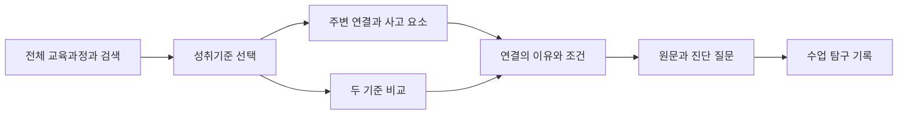

# 수학 교육과정 포털 조사와 구현 계획

작성일: 2026년 10월 29일

최신 화면 재설계 기준은 [수학 교육과정 포털 전면 리팩토링 계획](포털전면리팩토링계획.md)이다. 이 문서는 초기 조사와 설계 기록으로 보존하며, 아래의 구현 상태와 수치는 작성 당시 기준이다.

후속 설계: [교육과정 위계와 학습 순서 설계 계획](교육과정위계와학습순서설계계획.md). 개념 주변 지도의 배치에 앞서 선수 조건·발달 및 확장·교수 순서를 검토하는 작업을 우선한다. 아래의 기존 집계는 작성 당시 스냅샷이다.

교사와 연구자가 성취기준 사이의 연결을 탐구하고 수업을 설계하는 포털을 만든다. 핵심 경험은 **성취기준 찾기 → 주변 연결 살펴보기 → 연결의 이유와 조건 확인하기 → 사고 요소와 진단 질문을 수업 기록에 담기**다. 전체 교육과정을 조망하는 화면과 하나의 연결을 깊이 읽는 화면을 함께 제공한다.

첫 버전은 제공된 교육부 고시 제2022-33호를 기준으로 초중고 435개 성취기준과 상세 분석 초안을 다룬다. 공식 원문, 연구자의 분석, 개인 수업 기록을 화면에서 구별한다. 학생별 자동 진단과 맞춤 학습 순서 추천은 첫 버전의 범위에 포함하지 않는다.

## 현재 자료와 구현 기반

아래 집계는 2026년 10월 29일 오전 10시 15분 51초에 갱신된 관계 파일과 오전 10시 14분에 갱신된 분석 등록 파일 기준이다. SHA256 앞 12자리는 각각 `4e819ba93d8c`, `73c3bff0b634`다. 데이터가 계속 갱신될 수 있으므로 구현 시에도 JSON과 실제 분석 파일을 함께 확인한다.

| 자산 | 확인한 범위 | 포털에서의 용도 |
|---|---:|---|
| 공식 성취기준 | 435개: 초등 121, 중학교 60, 고등학교 254 | 전체 검색, 교육과정 위치, 원문 확인 |
| 고등학교 과목 | 15개 | 공통과 선택 과목의 분기 탐색 |
| 상세 분석 | 435개 전체 초안 | 대표 과제, 세부 사고, 오류, 진단 질문 |
| 세부 사고 요소 | 1,838개 | 선택한 성취기준의 사고 구조 펼치기 |
| 전체 관계 기록 | 3,611개 | 하위요소, 의미 연결, 확장, 조건, 대조 |
| 성취기준 사이 관계 기록 | 1,518개 | 주변 지도와 기록된 연결 경로 |
| 출처 | 18개 | 원문 위치와 문헌의 실제 검토 범위 |
| 검토 완료 및 학생 반응 검증 | 각각 0개 | 검토 상태를 명확히 표시 |

집계 근거는 [성취기준](../data/standards.json), [사고 요소](../data/elements.json), [관계](../data/relations.json), [분석 등록](../data/analysis_registry.json), [출처](../data/sources.json), [프로젝트 검증 결과](../data/project_validation.json)다. 문헌이 연결되어 있어도 해당 분석이나 진단의 효과가 검증되었다는 뜻은 아니다.

성취기준 간 관계 기록 1,518개는 고유한 출발·도착·유형 조합으로는 1,358개다. 같은 조합에 범위나 논증이 다른 기록이 있으므로 자동 삭제하지 않고 하나의 선에서 여러 설명을 펼친다. 현재 성취기준 435개 모두 관계에 참여하지만, 이것이 연결 분석의 충분성을 뜻하지는 않는다. 사고 요소 13개는 소속 기준 정보만 있고 명시적인 간선이 없어 화면에서 누락되지 않도록 확인해야 한다.

성취기준 사이 관계는 의미 연결 1,376개, 확장 135개, 대조 7개다. 성취기준 간 필수 선수 관계로 확정된 기록은 없다. 별도의 과제별 선수 조건 7개는 요소에서 목표로 향하는 가설이다. 따라서 첫 버전의 경로 탐색은 기록된 개념 연결을 설명하는 기능으로 설계한다.

원문 이미지 대조 기록은 32개이고 403개는 미대조다. 자동 구조 검증의 통과와 원문 대조 완료를 구별하며, 성취기준의 원문 위치와 대조 상태를 함께 표시한다.

초기 포털 HTML (`portal/math-atlas/dist/index.html`, 로컬 보존·Git 제외)과 스타일에는 탐색 메뉴, 상세 화면 영역, 연결 기록 대화상자, 내보내기 버튼이 있었다. 초기 조사 당시 `app.js`와 `data.js`는 없었으며 이후 구현과 전면 리팩토링에서 교체했다. 현재 스타일은 design.css (`portal/math-atlas/dist/design.css`, 로컬 보존·Git 제외)에 있다. 최신 구현은 별도 리팩토링 계획과 구현 결과를 따른다.

[내보내기 스크립트](../scripts/build_portal_data.py)는 초등 121개에 맞춰져 있다. 중고등 등록 항목을 처리할 때 초등 대표 사례용 분류 조회에서 오류가 생길 구조이며, 이후의 분석 121개 고정 검사도 현재 범위와 맞지 않는다. 구현의 첫 작업은 이 스크립트와 최신 분석 데이터 구조를 맞추는 것이다. 검토 완료 수의 고정값, 원문 추출문과 보정 이력 누락도 함께 정리한다.

구체적으로 초등의 `analysis_details.json` 118개와 대표 Markdown 3개, 중고등의 [secondary_analysis_details.json](../data/secondary_analysis_details.json) 314개를 같은 조회 형식으로 정규화한다. 초등의 공통 사고 묶음 29개와 중고등의 공통 분석 유형 28개는 구조가 다르므로, 이름만 바꿔 합치지 않고 개별 진단과 공통 진단의 역할을 보존한다.

## 참고 서비스와 적용할 아이디어

| 공식 사례 | 확인한 특징 | 이 포털에 적용할 설계 |
|---|---|---|
| [Achieve the Core Coherence Map](https://achievethecore.org/page/2801/learn-more-about-the-coherence-map) | 학년 내외 성취기준 연결, 선수 기준 역추적, 과제와 평가 자료 연결 | 선택한 기준의 주변 연결을 펼치고, 선을 선택해 이유와 조건 확인 |
| [Underground Mathematics](https://undergroundmathematics.org/useful-downloads/info-handout.pdf) | 큰 주제를 노선과 역으로 표현하고 탐구 질문과 자료를 연결 | 검토한 대표 주제에 한해 개념 노선도를 제공하고 공통 사고를 환승 지점처럼 표현 |
| [NRICH Curriculum Maps](https://nrich.maths.org/primary-curriculum-maps) | 교육과정 목표와 탐구 과제를 연결 | 성취기준에서 대표 과제, 발문, 진단 질문으로 바로 이동 |
| [Polypad](https://polypad.amplify.com/) | 분수 막대, 저울, 함수 기계 등 가상 조작물 | 후속 단계에서 핵심 개념 실험을 연결하고 초기에는 관련 활동 링크 활용 |
| [NCIC 교육과정 인벤토리](https://ncic.re.kr/inv/org/list.do) | 우리나라 교육과정의 원문과 분류 탐색 | 원문 확인의 출처로 연결하고 포털에는 분석과 관계 설명을 추가 |

이 비교에서 도출한 설계 방향은 **기준 중심 탐색, 큰 개념 흐름, 실제 수업 과제**의 결합이다. 해외 교육과정의 관계를 한국 성취기준에 그대로 옮기지 않는다. 서비스 기능은 공식 설명을 기준으로 확인했으며, 모든 조작을 실행한 사용성 평가를 뜻하지 않는다. 특히 Underground Mathematics의 현재 전체 화면 작동은 확인 범위에 포함하지 않는다.

## 교사의 탐구를 중심으로 한 화면 구성

### 교육과정 전체 보기

첫 화면에는 검색창과 학년군·학교급·영역별 전체 보기를 배치한다. 검색은 코드, 성취기준 문장, 분석 제목, 사고 요소를 대상으로 하며 검색 결과에 일치한 위치를 표시한다. 예를 들어 `6수01-10`, `비율`, `기준량`, `도형 분해`로 진입할 수 있다.

초등·중학교는 공식 학년군과 영역을 사용한다. 고등학교는 과목별 분기로 표현하고, 공통·일반선택·진로선택·융합선택 등의 분류를 원자료대로 유지한다. 서로 다른 학교급의 영역 이름을 임의로 동일시하지 않는다. 범교과 개념 묶음을 추가할 경우 공식 분류와 연구용 분류를 따로 표시한다.

2,273개 대상인 성취기준과 사고 요소를 처음부터 한 그래프에 모두 배치하지 않는다. 전체 보기에서는 묶음을 보여주고, 선택 이후에 필요한 개념과 관계를 펼친다. 관계 수가 많은 항목을 교육적으로 더 중요하다고 평가하지 않는다.

### 선택한 개념의 주변 지도

화면 중앙에는 선택한 성취기준과 직접 연결된 항목을 보여준다. 왼쪽에는 검색과 필터, 오른쪽에는 선택한 노드 또는 관계의 상세 설명을 둔다. 선택 상태와 필터는 탐색 뒤로 가기와 URL에서 복원할 수 있게 한다.

- 기본은 성취기준 노드이며, 사고 요소는 선택한 기준 안에서 펼친다.
- 첫 화면의 표시량은 약 30~50개 노드 이내를 초기 설계값으로 삼고 실제 자료로 조정한다. 더 많은 연결은 유형·영역별로 묶고 숨겨진 개수를 표시한다.
- 한 단계씩 확장하며 이미 선택한 기준의 위치가 크게 움직이지 않게 한다.
- 노드를 누르면 공식 목표와 상세 분석, 선을 누르면 연결의 이유와 조건을 연다.
- 그래프와 같은 내용을 관계 목록으로 제공한다. 모바일과 키보드 사용자는 목록만으로도 탐색을 마칠 수 있어야 한다.

### 연결의 이유와 조건

관계 상세는 다음 순서로 읽히게 구성한다. 기술적인 필드 이름은 화면에 노출하지 않는다.

1. 어떤 관계인가: 의미 연결, 의미 확장, 특정 과제의 조건, 대조 등.
2. 무엇이 이어지는가: 기존 의미 중 유지되는 부분과 사고의 변화.
3. 무엇을 더 배워야 하는가: 중간 개념, 추가 사고와 표현.
4. 언제 성립하는가: 과제·표현·수학적 조건과 대안 경로.
5. 무엇을 근거로 설명하는가: 원문, 수학적 분석, 문헌, 검토 상태.

색만으로 관계를 구별하지 않는다. 의미 연결은 관계 이름을 붙인 선, 확장은 방향이 있는 선, 하위요소는 포함·묶음, 대조는 비교 화면으로 표현한다. 과제별 선수 조건은 해당 과제를 선택했을 때 드러낸다. AND 조건은 함께 필요한 묶음으로 표시하며 개별 화살표만으로 대체하지 않는다.

원문 대조 상태, 분석 검토 상태, 학생 반응 검증 상태는 각각 다른 표지다. 모두 초안인 현재 데이터에 수치형 신뢰도나 검증 완료 비율을 만들어 붙이지 않는다. 이 원칙은 기존 [분석 규칙](분석규칙.md)을 따른다.

### 두 개념 비교와 연결 경로

두 성취기준을 선택하면 원문, 공통 사고, 달라지는 조건, 추가 학습, 진단 질문을 나란히 비교한다. 경로 탐색은 저장된 관계로 설명 가능한 연결을 제시한다. 경로의 간선 수가 적다는 이유만으로 가장 좋은 수업 순서라고 부르지 않는다.

`intermediate_standards`나 설명문에 등장하는 개념은 별도로 검토된 간선과 구별한다. 중간 개념 목록을 자동으로 직선 학습 순서로 바꾸지 않는다. 필터 때문에 경로가 없는 경우와 데이터에 경로가 기록되지 않은 경우도 구별한다.

### 수업 탐구 기록

교사는 성취기준, 관계 설명, 진단 질문을 선택해 하나의 수업 탐구 기록에 담는다. 기록에는 목표, 탐구 질문, 확인할 선수 사고, 대표 과제, 예상 반응, 추가 발문, 출처를 포함한다. 개별 성취기준의 진단과 개념군 공통 질문을 구별해 중복 수집을 줄인다.

첫 버전은 브라우저 저장과 JSON 백업·복원, 인쇄용 보기를 제공한다. 저장 범위가 해당 브라우저라는 점과 내보내기 방법을 명시한다. 개인 메모와 추가 연결은 원본 연구 데이터와 분리해 저장한다. 개인 연결의 기본 상태는 제안이며 기존 관계의 검토 상태를 상속하지 않는다.

## 실제 자료로 구성할 시범 탐구

### 자연수 나눗셈의 몫과 비율

[6수01-10](../analyses/6수01-10.md)의 3m 끈을 네 사람에게 나누는 과제에서 시작한다. 전체를 먼저 네 등분하는 방법과 각 1m를 네 등분하는 방법을 비교하고, 기준 단위와 전체를 구별하는 질문을 확인한다. 이 목표는 자연수 나눗셈의 몫을 분수로 나타내는 것이며 분수 나눗셈과 구별한다.

이어 [6수02-03](../analyses/6수02-03.md)과 비교한다. 데이터의 `L005`는 이 둘을 의미 연결로 기록한다. 같은 `3/4`라도 분배의 몫과 두 양의 비교에서 역할과 단위가 다르다는 점을 보여주고, 기준량과 비교 방향이 바뀌는 질문을 수업 기록에 담는다.

### 비율에서 정비례와 반비례로

`6수02-03 → 9수02-07`의 `L007`은 정비례 관계로 범위를 한정한 확장이다. 한 쌍에서 구한 비율을 여러 대응쌍의 `y/x=k`로 확장하면서 변수, 공변, 표·식·그래프를 추가로 다룬다. 같은 성취기준에 반비례가 들어 있어도 반비례에서는 `xy`가 일정하다는 차이를 표시한다.

이 사례는 성취기준 전체를 하나의 선으로 묶을 때 생기는 과잉 해석을 점검하는 데 적합하다. 그래프에서는 노드의 전체 문장과 간선이 실제로 가리키는 부분 범위를 함께 보여준다.

### 몫에서 유리함수로

`6수01-10 → 10공수2-03-04`의 `L015`는 간접적인 확장이다. 기존 데이터에는 중간 성취기준 `9수02-01`, `9수02-10`, `9수02-14`와 문자식, 함수, 정의역, 그래프라는 추가 학습이 기록되어 있다. 이를 한 번의 직접 선수 관계로 표시하지 않고 중간 개념과 변화 지점을 펼치는 사례로 사용한다.

수 영역에 편중되는지 확인하기 위해 [6수03-14](../analyses/6수03-14.md)의 도형 분해·합성 및 넓이 추론도 함께 검토한다. 같은 UI로 기하적 사고와 여러 해결 경로를 충분히 설명할 수 있어야 한다.

## 데이터와 버전 설계

현재 JSON과 Markdown을 원본으로 유지하고 포털용 산출물은 다시 생성할 수 있게 한다. 한 번의 빌드는 동일한 데이터 스냅샷을 사용하고, 생성 이후 원본이 바뀌면 재생성 대상으로 표시한다. 코드만 같은 다른 교육과정 문서를 같은 항목으로 합치지 않는다.

| 대상 | 유지하거나 보완할 정보 |
|---|---|
| 교육과정 판본 | 고시 번호, 고시일, 원본 파일 해시, 적용 정보, 원문 URL |
| 성취기준 | 판본을 포함한 ID, 코드, 학교급, 학년군, 과목, 영역, 추출문, 표시문, PDF 실제 쪽과 인쇄 쪽 |
| 상세 분석 | 대표 과제, 개별 사고와 진단, 공통 개념군, 오류, 표상, 문헌 검토와 학생 검증 상태 |
| 관계 | 양끝 ID, 유형, 범위, 이유, 조건, 추가 학습, 중간 개념, 한계, 출처, 검토 상태 |
| 조건 묶음 | 과제 또는 경로 ID, AND·OR 구성, 대안 경로와 적용 범위 |
| 수업 기록 | 선택 항목 ID, 데이터 판본, 교사 메모, 개인 관계, 수정 시각 |

관계의 방향과 탐색 규칙을 유형별로 정의한다. 포함 관계를 선수 조건으로 해석하지 않고, 의미 확장을 거꾸로 읽을 때도 본래 설명 방향을 보존한다. 같은 두 항목 사이에 여러 관계가 있으면 범위와 설명을 보존한 채 화면에서 묶어 표시한다.

성취기준 해설, 적용 시 고려 사항, 지식·이해와 과정·기능 등의 내용 체계가 어느 수준까지 구조화되어 있는지도 확인한다. 현재 성취기준 목록만으로 교육과정 문서 전체가 데이터화되었다고 간주하지 않는다. 검색용 동의어와 범교과 개념 태그는 검토 가능한 별도 사전으로 관리한다.

기준 문서는 [교육부의 2022-33호 고시](https://www.moe.go.kr/boardCnts/viewRenew.do?boardID=141&boardSeq=93458&lev=0)다. [국가교육위원회는 2026년 1월 21일 후속 일부개정 고시를 안내](https://www.ne.go.kr/user/bbs/BD_selectBbs.do?q_bbsDocNo=20260121102419070&q_bbsSn=1016)하고 있다. 따라서 서비스에는 기준 판본을 명시하며, 최신 수학과 내용과의 차이 및 적용 범위는 별도 대조한다. 일부개정 고시가 있다는 사실만으로 수학 성취기준이 달라졌다고 단정하지 않는다.

추후 외부 시스템 교환을 고려하면 [1EdTech CASE](https://www.1edtech.org/standards/case/about)의 문서·항목·관계 구분을 참고할 수 있다. 초기에는 안정적인 식별자와 판본 관리를 적용하고, CASE 호환 내보내기는 후속 기능으로 둔다. NCIC의 공개 API 이용 가능 여부는 확인되지 않았으므로 자동 API 연동을 필수 의존성으로 잡지 않는다.

## 구현 방식

첫 버전은 **정적 웹 앱과 구조화된 데이터**, **Cytoscape.js 기반 관계 탐색**을 권한다. 기존 HTML과 스타일을 재사용하고 검색, 상세 패널, 상태 관리, 수업 기록을 모듈로 나눈다. 서버나 그래프 데이터베이스 없이 현재 규모의 자료를 읽고 탐색하는 방식부터 검증한다.

[Cytoscape.js](https://js.cytoscape.org/)는 그래프 탐색·분석과 여러 배치 방식을 제공하므로 읽기 중심의 관계 탐색에 맞는 후보다. 전체 조망은 일반 HTML 목록과 격자, 주변 관계는 그래프, 두 기준 비교는 표와 카드형 설명으로 구현한다. 모든 화면을 그래프로 통일하지 않는다. 배치 방식은 방향 관계와 의미 연결을 나누어 실제 데이터로 비교한다.

[React Flow](https://reactflow.dev/learn/layouting/layouting)는 나중에 교사가 노드를 직접 배치하는 편집기가 핵심 기능이 될 때 재검토한다. 현재 단계에서 두 그래프 라이브러리를 동시에 도입하지 않는다. 초기에는 외부 로그인 없이 탐색과 개인 기록을 지원하고, 공동 편집이 필요해지는 단계에서 사용자와 권한, 서버 저장을 추가한다.

빌드 산출물은 전체 검색용 목록, 관계와 사고 요소, 기준별 상세 분석으로 나눌 수 있다. 상세 Markdown을 처음부터 모두 내려받을지 지연 로딩할지는 실제 전송 크기와 초기 표시 시간을 측정해 결정한다. 수식 표현과 원문 문장을 안전하게 표시하고, 메모와 Markdown은 HTML로 실행되지 않도록 처리한다.

배포 단계에서는 기존 Site 식별자와 소스 상태를 먼저 확인하고 같은 프로젝트를 이어 쓸지 결정한다. 이번 작업의 범위는 조사와 계획이며, 사이트 생성이나 배포는 수행하지 않았다.

## 단계별 구현 계획

| 단계 | 작업 | 완료 기준 | 예상 개발 작업일 |
|---|---|---|---:|
| 1 데이터 연결 | 최신 초중고 분석 통합, 내보내기 수정, 판본·원문·검토 상태 정리 | 435개 분석을 오류 없이 내보내고 집계를 실제 데이터에서 계산 | 2~3일 |
| 2 탐색 기본 화면 | 전체 검색, 학년군·과목별 보기, 상세 분석, 원문 위치 | 초중고 어느 기준에서도 원문과 개별 진단을 찾을 수 있음 | 3~4일 |
| 3 관계 탐구 | 주변 그래프, 관계 상세, 유형 필터, 사고 요소 펼치기 | 시범 탐구 네 가지를 근거와 조건까지 확인 가능 | 3~5일 |
| 4 수업 설계 | 두 기준 비교, 기록된 경로 조회, 탐구 기록 저장·내보내기 | 선택한 기준과 질문으로 수업 기록을 만들고 다시 불러옴 | 3~4일 |
| 5 교사 사용 검토 | 접근성, 화면 크기, 성능, 데이터 갱신, 실제 교사 피드백 | 핵심 탐구 과제를 수행하고 관계 의미를 구별할 수 있음 | 2~3일 |

합계 13~19개발 작업일은 숙련 개발자 1명, 기존 자료 재사용, 별도 로그인과 공동 편집 제외를 가정한 계획용 추정이다. 교육과정 원문 전수 대조, 수학적 독립 검토, 학생 반응 연구에 필요한 시간은 별도다. 첫 시연은 3단계 완료 시점으로 잡고 교사 피드백을 4단계에 반영한다.

검증 우선순위는 데이터의 의미 보존과 실제 탐구 수행이다. 구현 전후에 다음 항목을 확인한다.

- 모든 성취기준과 분석이 접근 가능하며 파일·ID·출처 참조가 맞는다.
- 관계 설명의 범위·조건·한계·추가 학습이 원본과 일치한다.
- 포함·의미 연결·확장·과제별 조건이 화면과 경로 탐색에서 섞이지 않는다.
- 고등 과목을 모든 학생이 순차 이수하는 일렬 구조로 표시하지 않는다.
- 기록되지 않은 연결, 필터로 가려진 연결, 실제로 선택한 경로를 구별한다.
- 원문 대조와 분석 검토, 학생 반응 검증 상태를 독립적으로 표시한다.
- 저장한 교사 메모를 새로고침 후 복원하고 내보낸 파일을 다시 가져올 수 있다.
- 한글·수식·긴 성취기준이 잘리지 않으며 색과 마우스 조작 없이도 같은 정보를 읽을 수 있다.
- 실제 데이터로 검색, 첫 화면, 주변 지도 반응 시간을 측정한다. 초기 목표는 검색 반응 200ms 이내, 대표 주변 지도 표시 1초 이내이며 측정 기기와 조건을 함께 기록한다.

교사 사용 검토는 초등·중등·고등 교사를 포함한 3~5명의 소규모 형성 평가로 시작한다. 목표 성취기준 찾기, 관계의 이유와 한계 설명하기, 진단 질문을 골라 수업 기록 만들기의 세 과제를 수행하게 한다. 수행 시간과 오해한 관계를 기록해 화면을 수정하며, 소규모 사용성 평가를 학습 효과의 증거로 표현하지 않는다.

## 첫 구현 범위

우선 완성할 것은 **435개 검색과 상세 분석, 한 단계 주변 지도, 연결 근거 패널, 원문 확인, 수업 탐구 기록**이다. 이후 두 기준 비교와 기록된 경로 탐색을 확장한다. 교사의 연결 제안과 검토 이력, 협업, 교육과정 판본 비교, 조작형 개념 실험은 다음 단계로 둔다.

첫 화면의 중심에는 검색과 탐구 진입점을 배치한다. 초기 시범은 몫의 분수 표현과 비율, 비율과 정비례, 몫과 유리함수의 간접 연결, 도형의 넓이 추론으로 구성한다. 이 사례들에서 연결을 읽고 수업 질문을 만들 수 있는지 확인한 뒤 전체 탐구 경험을 다듬는다.
