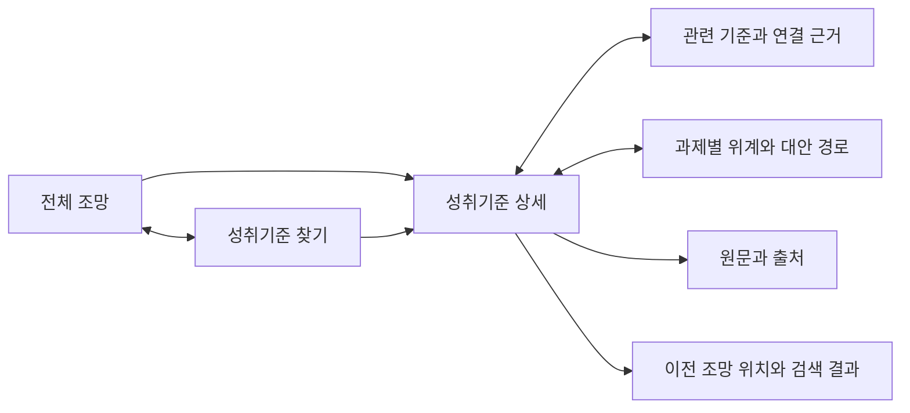

# 수학 교육과정 포털 전면 리팩토링 계획

작성일: 2026년 10월 29일

실행 결과: [포털 리팩토링 구현 결과](포털리팩토링구현결과.md). 전체 조망과 독립 상세, 연결·위계 통합을 구현하고 기존 사이트에 반영했다.

초·중·고 교육과정 전체를 조망하고, 어느 성취기준이든 충분한 폭의 독립된 페이지에서 읽을 수 있도록 포털의 정보 구조와 화면을 다시 설계한다. 기본 탐색 흐름은 **전체 구조 파악 → 성취기준 선택 → 내용 이해 → 연결과 학습 경로 탐구 → 원래 위치로 돌아오기**다.

이번 요청의 산출물은 현재 구현을 조사한 재설계 계획이다. 아래 화면과 기술 구조는 다음 구현의 기준이며, 구현 완료 상태를 뜻하지 않는다. 이 문서를 화면 리팩토링의 최신 계획으로 사용하고, 기존 포털 계획은 이전 설계 기록으로 보존한다. [위계 설계 계획](교육과정위계와학습순서설계계획.md)과 [분석 규칙](분석규칙.md)의 근거 구분 원칙은 유지한다.

## 1 현재 문제와 바꿀 방향

| 현재 확인한 문제 | 사용자에게 생기는 어려움 | 새 설계 결정 |
|---|---|---|
| 전체 보기가 학교급 카드와 학년군·과목 바로가기로 구성됨 | 초등에서 고등까지 어떤 내용이 놓여 있는지 함께 보기 어려움 | 별도의 전체 조망 화면을 첫 진입점으로 제공 |
| 고등 과목은 공통수학1·2가 먼저 나오고 13과목이 접혀 있음 | 선택 과목의 전체 구조를 파악하기 어려움 | 15과목의 이름과 공식 과목군을 조망에서 함께 표시 |
| 모든 화면에 범위 선택과 큰 소개 영역이 반복됨 | 실제 성취기준 본문이 첫 화면 아래로 밀림 | 간결한 공통 헤더와 화면 목적에 맞는 도구 배치 |
| 성취기준을 누르면 연결 탐구로 이동하고 원문·분석은 오른쪽 약 420px 패널에 표시됨 | 기준 자체를 읽기보다 관계부터 탐색하게 됨 | 성취기준 전용 상세 페이지 신설 |
| 전체 분석은 별도 팝업이며 일부 내용이 반복됨 | 읽던 위치와 문서의 전체 구조를 놓침 | 본문과 목차에서 모든 분석에 접근하고 중복 표시 정리 |
| 비율 사례에서 기본 관계 목록에 123개 묶음이 한꺼번에 표시됨 | 핵심 내용과 연결 이유를 찾는 데 많은 스크롤 필요 | 학교급·관계 유형별 묶음과 명시적인 펼치기 제공 |
| 검색 조건·선택 관계·화면 상태가 여러 함수에 분산됨 | 직접 링크, 뒤로가기, 새로고침의 결과가 일관되지 않을 가능성 | URL과 화면 상태의 규칙을 먼저 정의 |
| 전체 분석을 포함한 약 7.55MB의 data.js를 모든 화면에서 읽음 | 구조만 보는 경우에도 전체 자료를 읽어야 함 | 목록용 자료와 상세 자료의 분리 |

화면 확인은 현재 로컬 포털의 전체 보기와 성취기준 연결 탐구를 대상으로 했다. 코드 근거는 index.html (`portal/math-atlas/dist/index.html`, 로컬 보존·Git 제외), app.js (`portal/math-atlas/dist/app.js`, 로컬 보존·Git 제외), scope.js (`portal/math-atlas/dist/scope.js`, 로컬 보존·Git 제외), design.css (`portal/math-atlas/dist/design.css`, 로컬 보존·Git 제외)다.

## 2 다루는 자료와 조망의 기준

기준 범위는 제공된 교육부 고시 제2022-33호 별책8에서 목록화한 성취기준 435개다. 최신 개정 반영 여부나 제공 문서 밖 과목을 포함한 범위를 뜻하지 않는다.

| 구분 | 공식 묶음 | 성취기준 수 |
|---|---|---:|
| 초등학교 | 1~2학년군 / 3~4학년군 / 5~6학년군 | 29 / 47 / 45, 합계 121 |
| 중학교 | 1~3학년군 | 60 |
| 고등학교 공통 | 공통수학1·2, 기본수학1·2 | 73 |
| 고등학교 일반 선택 | 대수, 미적분Ⅰ, 확률과 통계 | 54 |
| 고등학교 진로 선택 | 미적분Ⅱ, 기하, 경제 수학, 인공지능 수학, 직무 수학 | 88 |
| 고등학교 융합 선택 | 수학과 문화, 실용 통계, 수학과제 탐구 | 39 |
| 전체 | 고등학교 15과목 포함 | 435 |

현재 상세 분석 초안은 435개, 사고 요소는 1,879개, 전체 관계 기록은 3,652개다. 화면의 집계는 이 수치를 상수로 넣지 않고 생성 데이터에서 계산한다. 관계 기록 수와 고유한 연결 수는 구별한다.

공식 조망에는 학교급·학년군·과목군·과목·내용 영역을 사용한다. 중학교 내용을 임의로 1·2·3학년에 배정하지 않고, 고교 선택 과목을 일렬의 필수 이수 순서로 그리지 않는다. 기본수학1·2는 공통수학1·2의 대체 이수 과목이라는 원문 설명을 반영한다. 고교 분류 근거는 제공 PDF 59쪽, 인쇄 53쪽이다.

초·중학교의 내용 영역과 고교 과목별 영역을 강제로 같은 네 행에 넣지 않는다. 학교급을 가로지르는 주제별 묶음은 별도 연구용 분류로 관리한다. 공식 교육과정의 위치, 의미 연결, 과제별 선수 조건은 각자의 표현을 사용한다.

## 3 사이트 구조와 이동 방식

상단 주요 메뉴는 **전체 조망 / 성취기준 찾기 / 연결과 위계 / 자료 안내**로 정리한다. 성취기준 상세는 모든 탐색에서 공통으로 도착하는 독립 페이지다.



| 화면 | 사용자가 답을 얻어야 하는 질문 | 주된 행동 |
|---|---|---|
| 전체 조망 | 전체에 무엇이 있고 이 내용은 어디에 있는가 | 묶음 확대, 학교급 비교, 기준 선택 |
| 성취기준 찾기 | 찾는 코드나 개념이 어느 기준에 있는가 | 검색, 필터, 원문 확인, 상세 열기 |
| 성취기준 상세 | 무엇을 이해하고 어떤 수행을 할 수 있어야 하는가 | 본문 읽기, 과제·진단 확인, 관련 기준 이동 |
| 연결과 위계 | 어떤 이유와 조건에서 다른 내용으로 이어지는가 | 관계 선택, 근거 읽기, 설명 경로 전환 |
| 자료 안내 | 원문과 분석은 어떤 자료와 검토에 근거하는가 | 판본, 출처, 검토 범위 확인 |

선택한 학교급은 찾아보기와 연결 탐색의 범위를 조절한다. 개별 성취기준의 직접 링크는 저장된 범위에 관계없이 열린다. 관련 기준을 따라 다른 학교급으로 이동해도 원래 검색 조건은 보존하고, 현재 기준이 그 범위 밖이라는 표시만 제공한다.

## 4 초중고 전체 조망 화면

### 기본 배치

첫 화면에서 초등·중학교·고등학교가 모두 보이게 한다. 큰 홍보 문구 대신 짧은 제목, 전체 수, 판본, 통합 검색을 배치하고 그 아래에 교육과정의 구조를 바로 보여준다.

조망의 기본 진입은 저장된 학교급 선호와 무관하게 초·중·고 전체로 연다. 조망에서 사용자가 명시적으로 좁힌 범위만 해당 URL에 저장한다. 필터가 있으면 전체 435개와 현재 표시 개수를 함께 보여주고 전체로 돌아가는 동작을 제공한다.

| 상단 | 공통 메뉴 · 통합 검색 · 기준 판본 |
|---|---|
| 도구 | 전체 435개 · 학교급 범위 · 구조 보기 / 성취기준 펼쳐 보기 |
| 초등 영역 | 1~2 / 3~4 / 5~6학년군을 열로, 공식 내용 영역을 행으로 배치 |
| 중학교 영역 | 1~3학년군 아래 공식 내용 영역별 내용 묶음 배치 |
| 고등 영역 | 공통 / 일반 선택 / 진로 선택 / 융합 선택별로 15과목 표시 |
| 선택 영역 | 선택한 묶음의 기준 목록과 현재 교육과정 위치 |

넓은 화면에서는 세 학교급 영역을 나란히 배치하고, 각 영역 안의 분류 체계는 유지한다. 한 셀에는 영역명, 성취기준 수, 대표 내용의 짧은 제목을 표시한다. 고등학교는 과목을 고르면 그 과목의 공식 영역과 기준이 펼쳐진다. 초기 조망에서도 15개 과목의 존재를 확인할 수 있게 한다.

### 정보 밀도와 상호작용

1. **구조 보기:** 학교급·학년군·과목군의 전체 분포와 주요 내용을 읽는다. 축약된 항목에는 전체 개수와 펼치기 동작을 표시한다.
2. **성취기준 펼쳐 보기:** 공식 묶음 아래 코드와 짧은 제목을 펼쳐 435개 전체를 빠짐없이 찾아볼 수 있게 한다. 길이는 페이지 스크롤로 처리하고 각 셀 안에 작은 스크롤 영역을 중첩하지 않는다.
3. **기준 미리보기:** 항목 선택 시 원문, 학년군·과목, 핵심 의미를 간결하게 보여준다. 미리보기에는 상세 페이지로 가는 명시적인 링크를 둔다.
4. **상세 이동과 복귀:** 기준을 열고 돌아오면 펼친 묶음, 필터, 스크롤 위치와 선택 표시가 복원된다.

검색하면 일치한 묶음과 기준을 강조하고 일치 수를 표시한다. 전체 구조를 유지할지 검색 결과 목록으로 이동할지 사용자가 선택할 수 있게 한다. 검색 때문에 숨겨진 항목과 원래 자료가 없는 영역을 구별한다.

전체 조망에는 모든 관계선을 한꺼번에 그리지 않는다. 기준이나 주제를 선택했을 때 해당 연결만 강조하고, 연결의 이유는 별도 탐구 화면에서 읽는다. 이후 주제별 흐름 보기를 추가할 때에도 공식 구조 보기로 돌아가는 경로를 유지한다.

### 작은 화면

학교급을 세로 구획으로 배치하고 현재 구획으로 이동하는 짧은 내비게이션을 제공한다. 학년군·과목군을 펼쳐 같은 항목을 찾을 수 있게 하며, 데스크톱 지도 축소판을 작은 글씨로 밀어 넣지 않는다. 가로 스크롤이 필요한 시각화에는 동등한 목록 탐색을 제공한다.

## 5 성취기준 상세 페이지

### 처음 보이는 내용

상단에는 교육과정 위치, 분석용 제목, 코드, 공식 원문을 배치한다. 제목은 연구자가 붙인 요약 제목이고 원문은 별도 본문임을 명확히 한다. 첫 화면에서 최소한 **어느 기준인지, 공식적으로 요구하는 내용이 무엇인지, 핵심 의미가 무엇인지**를 읽을 수 있어야 한다.

데스크톱은 약 720~840px의 읽기 본문과 200~240px의 목차·교육과정 위치 보조 열을 기본으로 한다. 연결 지도처럼 넓은 공간이 필요한 내용은 본문 아래 전체 폭을 쓴다. 원문과 핵심 의미는 접지 않고, 긴 참고 기록과 부가 설명만 펼침 영역으로 제공한다.

```text
전체 조망 / 초등학교 / 5~6학년군 / 변화와 관계

비율의 분수 소수 백분율 표현                 6수02-03
공식 성취기준 원문                          PDF 해당 쪽

읽기 본문                                  이 페이지의 내용
  핵심 의미                                  핵심 의미
  사고 요소와 관찰할 수행                     사고와 수행
  대표 과제와 풀이 경로                       과제와 경로
  진단 질문과 예상 반응                       진단 질문
  관련 성취기준                               연결
  출처와 검토 범위                            출처

찾아보던 목록으로 돌아가기 · 이 기준의 전체 위치 보기
```

### 본문 순서와 표현

| 구역 | 표현 방식 | 데이터 처리 원칙 |
|---|---|---|
| 공식 원문과 교육과정 위치 | 원문 인용 영역, PDF·인쇄 쪽수, 출처 링크 | 추출문·보정문·대조 상태를 보존 |
| 핵심 의미 | 짧은 해설과 해당 기준의 범위 | 공식 원문과 연구 분석 구분 |
| 사고 요소와 수행 | 사고 이름 → 필요한 판단 → 관찰할 수행 | 구성 요소의 나열에 필수 학습 순서 의미를 부여하지 않음 |
| 대표 과제와 경로 | 과제 본문, 설명 과정, 대안 풀이·표현 | 실제 존재하는 과제와 경로만 표시 |
| 진단 질문 | 질문 / 기대 설명 / 다른 반응의 가능한 해석 / 후속 발문 | 넓은 화면은 표, 작은 화면은 질문별 블록 |
| 관련 성취기준 | 기준의 제목·코드·학교급과 연결 이유의 요약 | 이전 학교급·같은 학교급·다른 학교급과 관계 유형을 구별 |
| 위계와 대안 경로 | 해당 기준을 포함하는 시범 경로의 진입점 | 경로가 없는 기준에 가상의 위계를 생성하지 않음 |
| 출처와 검토 범위 | 원문 대조, 분석 검토, 학생 반응 검증을 구분 | 문헌 인용 여부를 검증 완료로 바꾸지 않음 |

현재 팝업의 전체 분석 기록은 별도 팝업을 필수로 열지 않아도 읽을 수 있게 한다. 구조화한 본문과 겹치는 부분은 반복하지 않고, 아직 구조화하지 못한 추가 분석은 같은 페이지의 명시적인 절로 남긴다. 수식·표·한국어 긴 문장·분수와 부등호를 실제 자료로 점검한다.

목차 링크는 현재 절을 표시하고 URL로 공유할 수 있게 한다. 목록의 이전·다음 기준은 **현재 검색 결과 순서**임을 표시한다. 연결 관계나 학습 선후로 오해하게 만들지 않는다. 인쇄에서는 원문, 본문, 출처를 읽기 좋은 순서로 출력한다.

## 6 연결과 위계 화면

연결 탐구는 선택한 기준의 제목과 원문 요약을 고정된 문맥으로 제공한다. 관계를 선택해도 기준 자체의 문맥은 유지하고, 근거 영역만 바뀌게 한다. 연결의 범위, 이유, 새로 필요한 사고, 성립 조건, 출처 순서로 읽는다.

같은 출발·도착·관계 유형의 여러 기록은 하나의 연결 묶음으로 보여주되 각각의 설명을 보존한다. 전체 개수와 접힌 개수를 표시하고 학교급·관계 유형별로 펼칠 수 있게 한다. 기본 노출량은 시범 화면에서 읽기 흐름을 확인해 정하며, 연결 수가 많다는 이유로 교육적으로 중요하다고 표시하지 않는다.

위계는 기존 세 개념군과 여섯 설명 경로를 출발점으로 사용한다. 과제별 조건, 의미 확장, 교수 제안의 차이를 선의 모양과 글자로 표시한다. AND 조건 묶음과 대안 경로를 보존하고, 경로를 바꿀 때 이전 경로의 조건이 남지 않게 한다. 그래프와 같은 정보를 목록으로 제공한다.

전체 조망의 학교급 배치와 과제별 위계의 방향은 서로 다른 의미다. 공통수학에서 고교 선택 과목으로 분기하는 교육과정 분류 자체를 검증된 선수 학습 관계로 취급하지 않는다.

## 7 시각 디자인 기준

전체 화면을 차분한 교육과정 자료집의 읽기 경험으로 통일한다. 흰색·연회색 바탕, 진한 본문색과 하나의 주 강조색을 쓰고 영역 색상은 작은 표식과 연결 안내에 제한한다. 기존 서비스의 이름과 수학 주제는 유지한다.

| 요소 | 설계 기준 |
|---|---|
| 헤더 | 주요 메뉴와 검색 중심, 전체 조망과 상세에서 일관된 위치 |
| 제목 | 페이지마다 핵심 제목 하나, 세부 화면에서 큰 소개 영역 반복 제거 |
| 본문 | 16~18px를 출발점으로 실제 읽기 확인, 충분한 행간과 문단 간격 |
| 내용 구획 | 제목·여백·구분선 중심, 모든 문장을 개별 카드로 감싸지 않음 |
| 색과 아이콘 | 글자 라벨을 동반하고 색만으로 학교급·관계·검토 상태를 전달하지 않음 |
| 상태 | 선택, 펼침, 현재 위치, 로딩, 오류, 빈 결과를 공통 방식으로 표시 |
| 작은 화면 | 본문을 먼저 배치, 목차·필터는 접어 사용, 긴 표는 의미 단위로 전환 |
| 접근성 | 키보드 이동, 보이는 초점, 제목 구조, 읽기 순서, 충분한 대비 확보 |

먼저 실제 자료로 전체 조망 1종과 상세 3종을 설계한다. 상세 사례는 초등 비율 `6수02-03`, 중학교 정비례·반비례 `9수02-07`, 고등 유리함수 `10공수2-03-04`를 사용한다. 도형·넓이 `6수03-14`와 긴 진단 표를 추가 점검해 특정 유형에만 맞는 템플릿이 되지 않게 한다.

## 8 데이터와 코드 리팩토링

### 데이터 정규화

원본 JSON·Markdown·PDF와 포털 표시용 데이터를 분리한다. 초등 추가 분석 118개, 대표 Markdown 3개, 중고등 분석 314개를 하나의 상세 조회 계약으로 제공한다. 배열의 열 위치에 의존하는 사고 단계와 진단을 의미 있는 필드로 변환하되, 기존 자료의 표현과 누락 여부를 확인한다.

초등 공통 사고 묶음 29개와 중고등 공통 분석 유형 28개는 구조 차이를 보존해 정규화한다. 공통 사고·표현·경로와 개별 성취기준의 과제·진단을 구별하고, 현재 포털에 충분히 전달되지 않는 중고등 공통 정보를 함께 연결한다.

특히 [build_portal_data.py](../scripts/build_portal_data.py)의 대표 사례 처리에서 `paths`가 비어 있고 넓이 사례의 `task`가 비는 문제를 먼저 해결한다. Markdown에는 남아 있는 내용을 구조화 화면에서도 읽을 수 있게 한다. [secondary_source_review.json](../data/secondary_source_review.json)의 공식 적용범위 메모, 보정 이력, 출처 식별자도 연결한다. 공식 해설과 적용 시 고려 사항은 확보한 범위만 제공하고 없는 내용을 자동으로 채우지 않는다.

목록용 색인에는 코드·제목·원문·학교급·학년군·과목군·과목·영역·검색용 사고 표현을 둔다. 긴 상세 분석은 별도 자료로 불러오고, 관계와 위계도 필요한 화면에서 읽는다. 원문 해시와 데이터 버전을 공유해 서로 다른 생성본이 섞이지 않게 한다. 자료가 로드되지 않으면 무한 로딩 대신 다시 시도할 수 있는 오류를 표시한다.

### 화면과 상태 분리

현재의 정적 제공 방식을 유지하면서 소스 모듈과 생성 산출물을 분리하는 방안을 기본으로 한다. 이번 요구를 구현하기 위한 서버나 데이터베이스는 필요하지 않다. 프레임워크 전환은 현재 기능에 필요한 변경량과 얻는 이점을 확인한 경우에만 별도로 결정한다.

| 책임 | 분리할 내용 |
|---|---|
| 데이터 계층 | 성취기준·분류·검색 색인·관계 묶음·상세·출처 조회 |
| 라우터 | 화면 진입, 기존 링크 변환, 직접 링크, 뒤로가기와 새로고침 |
| 페이지 | 조망, 찾기, 성취기준 상세, 연결, 위계, 자료 안내 |
| 공통 UI | 헤더, 경로 표시, 필터, 기준 항목, 원문, 진단 표, 출처, 상태 표시 |
| 스타일 | 색·간격·활자 변수, 공통 요소, 페이지 배치, 작은 화면, 인쇄 |
| 생성 과정 | 원자료 정규화, 목록 색인, 상세 파일, 참조·개수 검증, 배포 산출물 |

라우트 예시는 `#view=overview`, `#view=catalog`, `#view=standard&code=6수02-03`, `#view=connections&code=6수02-03&relation=L007`이다. 위계는 개념군과 선택 경로를 URL에 보존한다. 기존 `map`과 `explore` 링크는 각각 새 찾기와 연결 탐구로 호환한다.

상세 목차는 `#view=standard&code=6수02-03&section=diagnosis`처럼 같은 라우트에 절 식별자를 넣는다. 절 이동 때문에 화면과 성취기준의 URL 정보가 사라지지 않게 하고, 직접 진입 시 자료를 읽은 뒤 해당 절로 이동한다.

검색어·학교급·학년군·과목·영역·선택 기준·관계·경로는 URL에서 복원한다. 결과 표시량, 펼침, 스크롤·초점은 방문 기록별 화면 상태로 보존한다. 저장된 사용자 선호보다 직접 링크의 명시적 조건을 우선한다. 초기 실행뿐 아니라 모든 라우트 이동에서 같은 복원 규칙을 적용한다.

현재 수정 중인 파일과 미추적 파일을 먼저 보존한 뒤 전환한다. `styles.css`와 `atlas.css`는 현재 HTML에서 쓰지 않으므로 다른 참조가 없는지 확인한 후 정리한다. 기존 Site 식별자와 접근 범위는 유지한다.

## 9 구현 순서와 단계별 완료 조건

| 단계 | 작업과 산출물 | 완료 조건 |
|---|---|---|
| 1 기준선과 데이터 계약 | 현재 변경 보존, 435개 및 상세 필드 감사, 누락 과제·경로 정규화, 라우트 규칙 | 원자료와 표시 데이터의 개수·참조 일치, 대표 사례 내용 복원 |
| 2 핵심 화면 설계 | 전체 조망과 초·중·고 상세 시안, 모바일 배치, 공통 활자·색·간격 | 실제 자료로 전체→상세→복귀 동선을 검토할 수 있음 |
| 3 공통 기반 | 데이터 조회, 라우터, URL 상태, 공통 UI와 스타일, 분리 로딩 | 직접 링크·새로고침·뒤로가기가 동일한 내용을 재현 |
| 4 전체 조망과 찾기 | 공식 구조 조망, 435개 펼침, 검색과 필터, 미리보기 | 세 학교급·15과목을 빠짐없이 찾고 상세로 이동 가능 |
| 5 성취기준 상세 | 독립 페이지, 목차, 원문·사고·과제·진단·출처·인쇄 | 435개 모두 본문 중심으로 접근, 자료가 있는 절의 누락 없음 |
| 6 연결과 위계 통합 | 관계 묶음과 근거, 기존 시범 경로, 목록 대안, 상세 복귀 | 관계 의미·AND 묶음·대안 경로·검토 상태 보존 |
| 7 통합 검증과 전환 | 실제 탐색 시나리오, 작은 화면·키보드·수식·성능 확인, 안내 갱신 | 아래 완료 기준 충족 후 기존 포털 대체 및 동일 Site 반영 |

첫 구현 단위는 실제 자료를 사용하는 **전체 조망 → 성취기준 상세 → 원래 위치 복귀**다. 이 흐름의 시각적 완성도와 상태 복원을 먼저 확보한 뒤 전체 범위와 관계 탐구로 넓힌다. 계정, 개인 수업 기록, 자동 추천 등 새로운 기능은 이번 핵심 화면 재설계와 별도의 후속 범위로 둔다.

## 10 최종 완료 기준

- 전체 조망에서 세 학교급, 세 초등 학년군, 중학교 학년군, 고교 네 과목군·15과목이 식별된다.
- 435개 기준이 누락·중복 없이 조회되며, 전체 목록을 펼치면 모든 코드와 제목에 접근할 수 있다.
- 성취기준을 열면 해당 기준의 제목과 공식 원문이 먼저 보이고, 관계 목록이나 팝업을 거치지 않고 분석을 읽는다.
- 조망이나 검색에서 들어가고 돌아왔을 때 필터·펼침·표시량·스크롤·선택이 복원된다.
- 초등만 보던 상태에서도 중고등 기준의 직접 링크가 정상적으로 열린다.
- 고등학교의 기본수학 대체 관계와 선택 과목 분류가 잘못된 필수 이수 순서로 표시되지 않는다.
- 대표 과제, 사고 요소, 진단, 공식 적용범위 메모, 출처가 원자료에서 화면까지 추적된다.
- 360px·768px·1280px·1440px의 대표 폭에서 본문 잘림이나 페이지 전체의 불필요한 가로 넘침이 없다. 지도·표의 가로 탐색에는 목록 대안이 있다.
- 키보드로 검색·필터·상세·목차·관계·복귀를 수행하고 현재 초점을 확인할 수 있다.
- URL 복사, 직접 진입, 새로고침, 뒤로가기, 존재하지 않는 코드, 검색 결과 없음, 자료 로딩 실패를 점검한다.
- 초기 조망이 435개 전체 분석 본문 다운로드를 요구하지 않는다. 같은 환경의 전후 초기 전송량과 첫 표시 시간을 비교한다.
- 기존 위계·학교급 범위 검증을 유지하고, 분류 전체 포함·상세 정규화·라우트 복원에 대한 의미 있는 검증을 추가한다.

현재 `test_hierarchy.cjs`와 `test_portal_scope.cjs`는 통과했다. 이 결과는 위계 자료와 범위 선택의 기준선이며, 새 조망·상세 화면의 사용성과 라우트 복원은 구현 후 별도로 검증한다.
